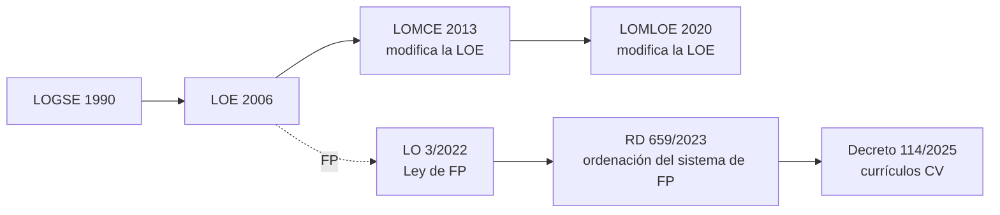

# 1. Sistema educativo y marco legal

Toda programación empieza por el **marco legal**: el tribunal espera que sepas situar tu módulo o tu materia dentro del sistema educativo y citar con precisión la normativa que lo regula. En este tema repasamos las leyes orgánicas de educación y la nueva ordenación de la Formación Profesional.

## 1.1. Las leyes orgánicas de educación

| Ley | Año | Situación |
|---|---|---|
| LOGSE (LO 1/1990) | 1990 | Derogada. Creó la ESO y los ciclos formativos de grado medio y superior |
| LOE (LO 2/2006) | 2006 | **Vigente**, con las modificaciones de la LOMCE y la LOMLOE. Regula la FP en los artículos 39 a 44 |
| LOMCE (LO 8/2013) | 2013 | Modificó la LOE; creó la FP Básica. Sus cambios han sido sustituidos por la LOMLOE |
| LOMLOE (LO 3/2020) | 2020 | **Vigente**. Modifica la LOE: enfoque competencial, situaciones de aprendizaje, inclusión |
| LO 3/2022 de FP | 2022 | **Vigente**. Ley de ordenación e integración de la Formación Profesional |

> [!TIP]
> Cuando cites la ley de educación, escribe *«Ley Orgánica 2/2006, de 3 de mayo, de Educación, modificada por la Ley Orgánica 3/2020, de 29 de diciembre (LOMLOE)»*. La LOMLOE no es una ley independiente: modifica la LOE.

## 1.2. La nueva Formación Profesional

La **Ley Orgánica 3/2022, de 31 de marzo**, crea un **sistema único de Formación Profesional** que integra la FP del sistema educativo y la FP para el empleo. La desarrolla el **Real Decreto 659/2023, de 18 de julio**, por el que se desarrolla la ordenación del Sistema de Formación Profesional.

### Los grados de la oferta de FP

| Grado | Oferta | Acreditación |
|---|---|---|
| A | Acreditación parcial de competencia | Acreditación parcial |
| B | Certificado de competencia | Certificado de competencia |
| C | Certificado profesional | Certificado profesional |
| **D** | **Ciclos formativos** (básico, medio y superior) | **Título** de Técnico Básico, Técnico o Técnico Superior |
| E | Cursos de especialización | Título de Especialista o Máster Profesional |

Como profesorado de Informática impartirás sobre todo en el **grado D** (ciclos formativos) y en el **grado E** (cursos de especialización, por ejemplo de ciberseguridad o de inteligencia artificial y *big data*).

### Carácter dual y formación en empresa

Toda la FP tiene ahora **carácter dual**: una parte de la formación se hace en la empresa (FE, formación en empresa u organismo equiparado), que sustituye a la antigua FCT. El Decreto 114/2025 de la Comunitat Valenciana establece dos regímenes:

| Régimen | Duración de la FE | Resultados de aprendizaje en la empresa |
|---|---|---|
| **General** | Entre el 25 % y el 35 % de la duración total del ciclo | Al menos el 10 % de los RA |
| **Intensivo** | Como mínimo el 35 % | Al menos el 30 % de los RA (con autorización) |

La FE **no tiene currículo propio**: contribuye a alcanzar parte de los resultados de aprendizaje de los módulos. Por eso tu programación debe indicar **qué RA se trabajan en la empresa**.

> [!IMPORTANT]
> Para empezar la FE, el alumnado debe haber adquirido antes las competencias de **prevención de riesgos laborales** del perfil, que se sitúan obligatoriamente en el primer trimestre del primer curso.

### Los módulos de los nuevos ciclos

Además de los módulos técnicos de cada título, todos los ciclos incluyen:

- **Itinerario personal para la empleabilidad I y II** (sustituyen a FOL y EIE).
- **Digitalización aplicada al sistema productivo**.
- **Sostenibilidad aplicada al sistema productivo**.
- **Inglés profesional**.
- **Proyecto intermodular**, basado preferentemente en retos.
- Un **módulo optativo** en segundo curso.

## 1.3. Normativa de la Comunitat Valenciana

| Norma | Qué regula |
|---|---|
| **Decreto 114/2025, de 29 de julio** | Currículos de los ciclos de grado medio y superior en aplicación de la LO 3/2022. Proyecto curricular de ciclo (art. 8) y **programación didáctica de módulo** (art. 9) |
| Resolución de inicio de curso | Instrucciones anuales de organización de los centros que imparten FP |
| Orden 79/2010 | Evaluación del alumnado de FP ([tema 5](/t05-evaluacion)) |
| Decreto 104/2018 y Orden 20/2019 | Inclusión educativa ([tema 6](/t06-inclusion)) |

> [!WARNING]
> La normativa de FP ha cambiado mucho desde 2022 y sigue cambiando. Antes de citar una norma en tu PD, comprueba en el BOE o el DOGV que sigue vigente y consulta su **versión consolidada**. La convocatoria exige programar con la normativa vigente en el curso de referencia.

## 1.4. Autonomía pedagógica de los centros

La LOE (artículo 120 y siguientes) reconoce la **autonomía pedagógica, de organización y de gestión** de los centros. Esa autonomía es la que justifica que tú, como docente, concretes el currículo en tu programación, adaptándolo al contexto del centro y al alumnado ([tema 3](/t03-programacion-didactica)).

## Repaso


- t: "LOMLOE"
  d: "Ley Orgánica 3/2020, que modifica la LOE de 2006. No la sustituye."
- t: "LO 3/2022"
  d: "Ley de ordenación e integración de la Formación Profesional."
- t: "RD 659/2023"
  d: "Real decreto que desarrolla la ordenación del Sistema de FP."
- t: "Grado D"
  d: "Ciclos formativos: básico, medio y superior."
- t: "FE"
  d: "Formación en empresa u organismo equiparado. Sustituye a la FCT."
- t: "Decreto 114/2025"
  d: "Currículos de los ciclos de grado medio y superior en la Comunitat Valenciana."



- q: "¿Qué ley orgánica de educación está vigente?"
  options: ["La LOMLOE, que sustituyó a la LOE", "La LOE, modificada por la LOMLOE", "La LOMCE"]
  answer: 1
  explain: "La LOMLOE (LO 3/2020) es una ley de modificación: la ley vigente sigue siendo la LOE de 2006 con sus modificaciones."
- q: "En el régimen general de FP dual, la formación en empresa dura…"
  options: ["Menos del 25 % del ciclo", "Entre el 25 % y el 35 % del ciclo", "Más del 50 % del ciclo"]
  answer: 1
  explain: "El régimen general va del 25 % al 35 % de la duración total; el intensivo, a partir del 35 %."
- q: "¿En qué grado del sistema de FP están los cursos de especialización?"
  options: ["Grado C", "Grado D", "Grado E"]
  answer: 2
  explain: "El grado D son los ciclos formativos y el grado E los cursos de especialización."
- q: "¿Qué artículo del Decreto 114/2025 regula la programación didáctica de módulo?"
  options: ["Artículo 5", "Artículo 9", "Artículo 12"]
  answer: 1
  explain: "El artículo 9 enumera los apartados que debe incluir la programación didáctica de un módulo profesional."


<!-- MATERIAL:inicio -->
## Material de la asignatura

### Leyes orgánicas de educación

-  — Llei Orgànica d'Educació 2/2006, de 3 de maig de 2006
- [LOE](https://www.boe.es/buscar/pdf/2006/BOE-A-2006-7899-consolidado.pdf)
-  — Ley Orgánica 8/2013, de 9 de diciembre, para la mejora de la calidad educativa.
- 
- [Los efectos de la LOMCE en la FP](https://raulsolbes.com/2016/04/13/los-efectos-de-la-lomce-en-la-fp/)
-  — Esquema del sistema educatiu espanyol segons la Llei Orgànica de Millora de la Qualitat Educativa (LOMQE)

### Formación Profesional: ley y desarrollo

- 
- [LFP](https://www.educacionfpydeportes.gob.es/destacados/nueva-ley-fp.html#:~:text=La%20Ley%20Org%C3%A1nica%20de%20Ordenaci%C3%B3n,23%20de%20marzo%20de%202022.)
- [Dossier LFP](https://www.todofp.es/dam/jcr:99d1f05d-2db7-4898-89f8-faec6f3e76af/dossier-informativo-nueva-ley-fp-2022.pdf)
- 
- 
-  — Real Decreto 659/2023, de 18 de julio, por el que se desarrolla la ordenación del Sistema de Formación Profesional. de la ordenación y organización académica de los ciclos formativos de Formación Profesional del sistema educativo en el ámbito territorial de la Comunitat Valenciana. [2010/9539]
- 
- [Orden de Inicio de curso](https://ceice.gva.es/documents/388109149/394550702/Instrucciones+2025-26+DOGV+cas_firmado.pdf/943f8061-3f8d-6a4c-21fe-d0a0b5478c75?t=1752748668357)

### Gestión de la FP en la Comunitat Valenciana

- 
- 
- 
- 
<!-- MATERIAL:fin -->
