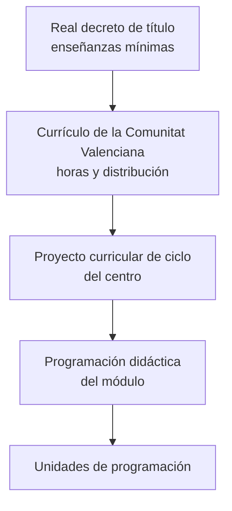

# 2. Las enseñanzas de informática: títulos y currículos

La especialidad **254 · Informática** del cuerpo de profesorado de Enseñanza Secundaria tiene atribución docente en la **Formación Profesional** de la familia de Informática y Comunicaciones y en materias de **ESO y Bachillerato** relacionadas con la informática y la digitalización. Antes de programar tienes que saber **dónde está escrito lo que vas a enseñar**.

## 2.1. Dos niveles de normativa: título y currículo

En FP siempre hay dos normas para cada ciclo:

| Norma | Quién la dicta | Qué contiene |
|---|---|---|
| **Real decreto de título** | Ministerio | Perfil profesional, competencias, módulos, **resultados de aprendizaje y criterios de evaluación**, contenidos básicos, orientaciones pedagógicas y enseñanzas mínimas |
| **Currículo autonómico** | Conselleria | Completa el título para la Comunitat Valenciana: horas de cada módulo, distribución por cursos y contenidos ampliados |

## 2.2. Los títulos de la familia de Informática y Comunicaciones

| Ciclo | Grado | Título | Real decreto |
|---|---|---|---|
| **SMR** | Medio | Técnico en Sistemas Microinformáticos y Redes | RD 1691/2007 |
| **ASIR** | Superior | Técnico Superior en Administración de Sistemas Informáticos en Red | RD 1629/2009 |
| **DAM** | Superior | Técnico Superior en Desarrollo de Aplicaciones Multiplataforma | RD 450/2010 |
| **DAW** | Superior | Técnico Superior en Desarrollo de Aplicaciones Web | RD 686/2010 |

La familia incluye también la **FP Básica** (Informática y Comunicaciones, Informática de Oficina) y **cursos de especialización** como Ciberseguridad en Entornos de las Tecnologías de la Información, Inteligencia Artificial y *Big Data* o Desarrollo de Videojuegos y Realidad Virtual.

> [!IMPORTANT]
> Estos reales decretos se han **modificado** después de su publicación (por ejemplo, el RD 405/2023 actualizó DAM y DAW, y el RD 499/2024 y el RD 500/2024 incorporaron los nuevos módulos comunes). En tu PD cita el real decreto original **y** sus modificaciones, y copia los RA y criterios de la **versión consolidada**.

### Cómo leer un real decreto de título

1. **Artículo de perfil profesional:** competencia general, competencias profesionales, personales y sociales, y cualificaciones profesionales incluidas.
2. **Objetivos generales** del ciclo (las letras a, b, c… que citarás en tu PD).
3. **Anexo I · Módulos profesionales:** para cada módulo, sus **resultados de aprendizaje** con sus **criterios de evaluación**, la **duración**, los **contenidos básicos** y las **orientaciones pedagógicas**, donde se dice qué objetivos generales y competencias trabaja el módulo y qué líneas de actuación se recomiendan.

> [!TIP]
> Las orientaciones pedagógicas del módulo son oro para tu PD: te dan la **justificación** del módulo y la relación con los objetivos generales y las competencias del título.

## 2.3. Los currículos de la Comunitat Valenciana

La Conselleria publica un currículo para cada ciclo (en la carpeta de material tienes los de SMR, ASIR, DAM y DAW). Desde el curso 2025/26, el **Decreto 114/2025** establece los currículos de los ciclos de grado medio y superior adaptados a la LO 3/2022. Fíjate en:

- la **carga horaria** de cada módulo en la Comunitat Valenciana, que es la que debes usar para temporalizar;
- la distribución de los módulos entre **primer y segundo curso**;
- los módulos nuevos (Itinerario para la empleabilidad, Digitalización, Sostenibilidad, Inglés profesional, Proyecto intermodular y optativa).

## 2.4. ESO y Bachillerato

En ESO y Bachillerato la referencia es el **currículo LOMLOE**: competencias clave, competencias específicas, criterios de evaluación y saberes básicos, que se trabajan mediante **situaciones de aprendizaje**.

| Etapa | Norma estatal | Norma de la Comunitat Valenciana |
|---|---|---|
| ESO | RD 217/2022, de 29 de marzo | Decreto 107/2022, de 5 de agosto |
| Bachillerato | RD 243/2022, de 5 de abril | Decreto 108/2022, de 5 de agosto |

Las materias más habituales para la especialidad son las de **Digitalización** y las de **Tecnología e Ingeniería** compartidas con otras especialidades, además de las optativas propias de la Comunitat Valenciana. Revisa el anexo del decreto para comprobar la atribución docente de cada materia.

## 2.5. Actividad: compara currículos

Elige un ciclo de la familia y compara el **currículo del Ministerio** (aplicable en el territorio que gestiona directamente) con el de la **Comunitat Valenciana**:

1. ¿Qué módulos y cuántas horas tiene cada uno? ¿En qué curso se imparten?
2. Elige un módulo y compara sus contenidos: ¿qué se ha añadido o concretado en la Comunitat Valenciana?
3. ¿Qué cambia con la incorporación de los nuevos módulos de la LO 3/2022?


- q: "¿Dónde están los resultados de aprendizaje y los criterios de evaluación de un módulo de FP?"
  options: ["En la orden de evaluación de la Comunitat Valenciana", "En el real decreto del título (anexo I)", "En la programación del departamento"]
  answer: 1
  explain: "Los RA y los criterios de evaluación son enseñanzas mínimas y los fija el real decreto de título, en su anexo I."
- q: "¿Qué horas usas para temporalizar un módulo en un instituto de Alicante?"
  options: ["Las del real decreto de título", "Las del currículo de la Comunitat Valenciana", "Las que decida el departamento"]
  answer: 1
  explain: "El real decreto fija las horas mínimas; la carga lectiva real en la Comunitat Valenciana la fija su currículo."
- q: "En ESO, ¿cómo se organizan los aprendizajes según la LOMLOE?"
  options: ["En unidades de trabajo", "En situaciones de aprendizaje", "En resultados de aprendizaje"]
  answer: 1
  explain: "En ESO y Bachillerato la programación de aula se desarrolla mediante situaciones de aprendizaje."


<!-- MATERIAL:inicio -->
## Material de la asignatura

### Reales decretos de título

-  — REAL DECRETO 1691/2007, de 14 de diciembre, por el que se establece el título de Técnico en Sistemas Microinformáticos y Redes y se fijan sus enseñanzas mínimas.
-  — Real Decreto 1629/2009, de 30 de octubre, por el que se establece el título de Técnico Superior en Administración de Sistemas Informáticos en Red y se fijan sus enseñanzas mínimas.
-  — Real Decreto 450/2010, de 16 de abril, por el que se establece el título de Técnico Superior en Desarrollo de Aplicaciones Multiplataforma y se fijan sus enseñanzas mínimas.
-  — Real Decreto 686/2010, de 20 de mayo, por el que se establece el título de Técnico Superior en Desarrollo de Aplicaciones Web y se fijan sus enseñanzas mínimas.

### Currículos de la Comunitat Valenciana y oferta

- 
- 
- 
- 
- [Oferta Ciclos de Informática en la Comunitat Valencianana](http://www.ceice.gva.es/web/formacion-profesional/oferta1)
- [Oferta Cursos Especialización a la Comunitat Valencianana](https://ceice.gva.es/es/web/formacion-profesional/dossier-de-cursos-d-especialitzacio)

### Ordenación de la FP

-  — Reial Decret 1147/2011, de 29 de juliol, per el que s'estableix l'ordenació general de la formació professional del sistema educatiu.
-  — ORDEN 46/2012, de 12 de julio, de la Conselleria de Educación, Formación y Empleo, por la que se regulan determinados aspectos de la ordenación de la Formación Profesional del sistema educativo en la Comunitat Valenciana.
- 
-  — Consideraciones a tener en cuenta en torno a la calificación del módulo profesional "Inglés técnico/Horario reservado para la docencia en inglés"

### ESO y Bachillerato

-  — Real Decreto 217/2022, de 29 de marzo, por el que se establece la ordenación y las enseñanzas mínimas de la Educación Secundaria Obligatoria del Ministerio de Educación y Formación Profesional
- [Enlace a curriculums ESO_Bachillerato Comunidad Valenciana](http://www.ceice.gva.es/es/web/ordenacion-academica/curriculo-eso-bachillerato-por-materias)
- [Curriculo BACH 2022](https://dogv.gva.es/datos/2022/08/12/pdf/2022_7578.pdf)
- [Enlace normativa referente a la ESO en la Comunidad Valenciana](http://www.ceice.gva.es/va/web/ordenacion-academica/secundaria/curriculo)
- 
- [Enlace documentos puente de la ESO en la Comunitat Valenciana](http://mestreacasa.gva.es/web/formaciodelprofessorat/dpsecundaria) — El enlace indicado esta referido al documento puente de secundaria para la planificación de la programación didáctica.
- [Curriculos Básicos por Enseñanzas LOMLOE](https://educagob.educacionfpydeportes.gob.es/eu/curriculo/curriculo-lomloe/menu-curriculos-basicos.html)
- [Curriculos LOMLOE](https://educagob.educacionfpydeportes.gob.es/curriculo/curriculo-lomloe/curriculos-ccaa.html)
- [Nuevo Curriculum](https://portal.edu.gva.es/noucurriculum/)
- [Curriculum LOMLOE](https://www.aprendecondanio.com/blog/lomloe/competencias-clave-saberes-basicos/)

### Para leer y reflexionar

- 
-  — Informe presentado por SCIE (Sociedad Científica Informática de España) y CODDII (Conferencia de Directores y Decanos de Ingeniería Informática) sobre la enseñanza preuniversitaria de la informática
<!-- MATERIAL:fin -->
