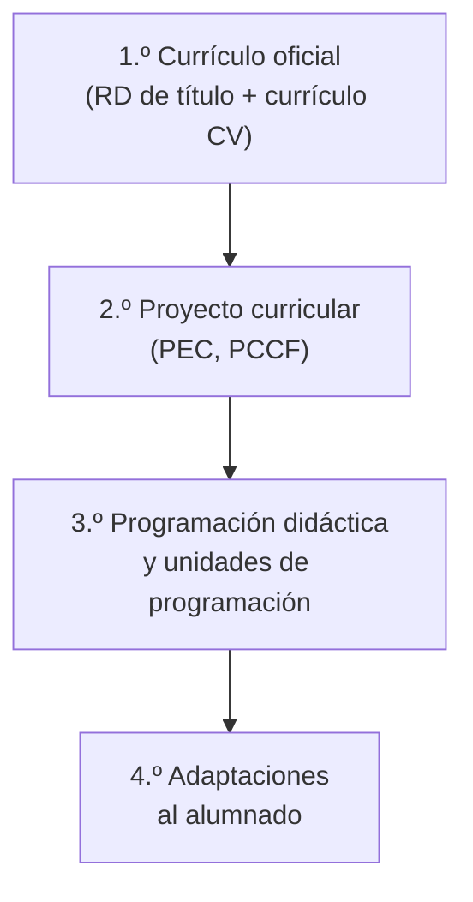

# 3. La programación didáctica

La **programación didáctica (PD)** es el documento en el que planificas un curso completo de un módulo o una materia: qué vas a enseñar, en qué orden, cómo y cómo vas a evaluarlo, adaptado a un centro y a un grupo concretos. En la oposición es, además, **el documento que defiendes ante el tribunal**.

## 3.1. Los niveles de concreción curricular

La PD no se inventa: concreta lo que ya fijan las normas de rango superior.

| Nivel | Documento | Quién lo elabora |
|---|---|---|
| **1.º** | Real decreto de título o de enseñanzas mínimas y currículo autonómico | Ministerio y Conselleria |
| **2.º** | Proyecto educativo de centro (PEC) y **proyecto curricular de ciclo** (PCCF) o de etapa | Centro y equipos docentes |
| **3.º** | **Programación didáctica** y unidades de programación | Departamento y profesorado |
| **4.º** | Adaptaciones para grupos o alumnado concreto | Profesorado, con el apoyo del departamento de orientación |

### Los documentos de centro

Tu PD debe ser coherente con los documentos del centro en el que la sitúas. Los más importantes son el **proyecto educativo (PEC)**, la **programación general anual (PGA)**, el **plan de acción tutorial**, el **plan de igualdad y convivencia**, el **plan de transición** y el **plan de fomento de la lectura**. En el material tienes los de un instituto real como modelo.

## 3.2. Qué debe contener: el Decreto 114/2025

El **artículo 9 del Decreto 114/2025** establece que la programación didáctica de un módulo profesional la elabora el departamento, teniendo en cuenta el proyecto curricular, e incluye:

1. Datos identificativos, marco normativo y contextualización del módulo.
2. Relación entre los estándares de competencia y los módulos del ciclo formativo.
3. Contribución de los resultados de aprendizaje a las competencias generales.
4. Esquema general y secuenciación de las **unidades de programación**.
5. Metodología del proceso de enseñanza-aprendizaje.
6. Recursos.
7. Uso de espacios y equipamientos.
8. Medidas de atención a la diversidad.
9. Evaluación del aprendizaje.
10. Actividades complementarias y extraescolares.
11. Criterios y procedimientos para evaluar el desarrollo de la programación y la práctica docente, y criterios de calificación.

## 3.3. Qué pide la convocatoria de oposiciones

La convocatoria de 2025 (Orden 1/2025) exige, para las especialidades de FP, que la PD **especifique e interrelacione**:

- objetivos (si el título es LOGSE), competencia profesional y unidades de competencia del módulo;
- los **resultados de aprendizaje** y su **distribución entre el centro y la formación en empresa**;
- criterios de evaluación y contenidos;
- metodología, incluido el uso de las TIC;
- conexiones con otros módulos profesionales;
- distribución temporal y agrupamiento del alumnado;
- medidas y apoyos para la atención a todo el alumnado en un sistema educativo inclusivo.

Además, debe tener **al menos seis unidades de programación desarrolladas**; si no las tiene, la prueba queda invalidada. No se pueden programar los módulos optativos, el proyecto intermodular, Sostenibilidad, Digitalización ni Itinerario personal para la empleabilidad II.

> [!NOTE]
> En **ESO y Bachillerato** se presenta una **programación de aula** de un curso, con enfoque competencial y **al menos seis situaciones de aprendizaje desarrolladas** (artículo 22 del Decreto 107/2022 y artículo 23 del Decreto 108/2022).

## 3.4. Una estructura que funciona

Esta es una distribución orientativa de las 60 páginas, que puedes adaptar a la convocatoria del año:

| Apartado | Contenido | Págs. |
|---|---|:-:|
| **1. Introducción** | Justificación, niveles de concreción, entorno del centro, características del alumnado, marco legal | 8 |
| **2. Objetivos y competencias** | Objetivos generales del ciclo, competencias del módulo, resultados de aprendizaje | 4 |
| **3. Contenidos** | Estructura del currículo, relación de unidades de programación, contenidos transversales, temporalización y secuenciación | 20 |
| **4. Metodología** | Principios metodológicos, estrategias, tipos de actividades, materiales y recursos, organización del aula | 8 |
| **5. Evaluación** | Criterios, procedimientos e instrumentos, calificación, recuperación, evaluación de la práctica docente | 12 |
| **6. Uso de las TIC** | Herramientas y *software* del módulo, búsqueda de información | 2 |
| **7. Atención a la diversidad** | Medidas de respuesta para la inclusión | 4 |
| **8. Formación en empresa** | RA y contenidos que se trabajan en la empresa | 1 |
| **9. Bibliografía y legislación** | Referencias actualizadas | 1 |

Puedes añadir actividades complementarias y extraescolares y anexos (como máximo 15 páginas: rúbricas, modelos de evaluación, plantillas).

## 3.5. Temporalización y secuenciación

Una buena PD demuestra que el tiempo **cuadra**:

1. Parte de la **carga horaria del módulo** en el currículo de la Comunitat Valenciana y de las horas semanales.
2. Sitúa el curso en el **calendario escolar** (festivos, evaluaciones y periodo de formación en empresa).
3. Reparte las horas entre las unidades de programación y comprueba que **la suma coincide** con el total.
4. Justifica el **orden**: de lo general a lo particular, de lo sencillo a lo complejo, siguiendo el proceso de trabajo real o coordinándote con otros módulos.

> [!TIP]
> Incluye una **tabla de doble entrada** que relacione cada unidad de programación con los RA y criterios que trabaja. Es la forma más rápida de demostrar al tribunal que cubres todo el currículo.

## 3.6. Cómo redactar los objetivos

Los objetivos y los criterios se redactan con **un verbo en infinitivo** que exprese una acción observable y evaluable: *identificar, describir, configurar, instalar, desarrollar, documentar, verificar…* Evita verbos como *saber*, *entender* o *conocer*, que no se pueden observar. En el material tienes una relación de verbos según el tipo de contenido.

## 3.7. Actividad del taller

Durante los talleres de noviembre vas a redactar tu PD por partes:

- **Taller I:** introducción (justificación, contexto, marco legal), objetivos, competencias, RA y contenidos.
- **Taller II:** relación de unidades, temporalización, metodología, evaluación, atención a la diversidad, recursos, TIC, actividades complementarias y FE.


- q: "¿En qué nivel de concreción curricular está la programación didáctica?"
  options: ["Primero", "Segundo", "Tercero"]
  answer: 2
  explain: "El primer nivel es el currículo oficial; el segundo, el proyecto curricular del centro; el tercero, la programación didáctica."
- q: "¿Cuántas unidades de programación desarrolladas exige como mínimo la convocatoria de 2025?"
  options: ["Seis", "Diez", "Quince"]
  answer: 0
  explain: "Si la PD no contiene al menos seis unidades de programación desarrolladas, la prueba queda invalidada."
- q: "¿Cuál de estos módulos NO se puede elegir para la PD en la convocatoria de 2025?"
  options: ["Bases de datos", "Proyecto intermodular", "Servicios en red"]
  answer: 1
  explain: "Quedan excluidos los optativos, el proyecto intermodular, Sostenibilidad, Digitalización e Itinerario personal para la empleabilidad II."


<!-- MATERIAL:inicio -->
## Material de la asignatura

### Guías y plantillas

- 
- 
- 
- **Orientaciones, verbos y ejemplos de UT**
  - 
  - 
  - 
  - 
  - 
  - 
  - 
  - 
  - 
- 
- 

### Documentos de centro

- **Documentos de Centro**
  - 
  - 
  - 
  - 
  - 
  - 
  - 
-  — Modelo de PD, utilizado en el IES Cavanilles, indicando los contenidos y formato que deben tener para los diferentes módulos de Formación Profesional.

### Ejemplos de programaciones de FP

- **Ejemplos Programaciones** — Ejemplos de una Programación Didáctica y una Unidad de Trabajo, que sirva como modelo del producto final a redactar por parte del alumnado de la asignatura.
  - 
  - 
  - 
  - 
  - 
  - 
  - 
  - 
  - 
  - 
  - 
  - 
- 
- 
- 

### Ejemplos de programaciones de ESO

- **Ejemplos de programaciones ESO**
  - 
  - 
  - 
  - 
  - 
  - 
  - 
- 

### Vídeos

- [Tecnológicas para diseñar experiencias educativas en FP](https://youtu.be/tiO1vndaT8o)
- [Infografía y visualización de datos para enseñanza-aprendizaje y difusión de la innovación](https://youtu.be/4hP7Q4LZWe8)
<!-- MATERIAL:fin -->
