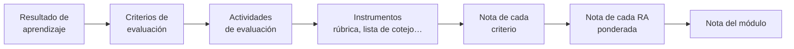

# 5. Evaluación

La evaluación es el apartado de la PD que más preguntas genera en el tribunal. Tienes que demostrar que sabes **qué** evalúas (resultados de aprendizaje y criterios), **cómo** lo evalúas (técnicas e instrumentos), **cuándo** (inicial, continua y final) y **cómo calificas**.

## 5.1. Normativa

| Norma | Ámbito |
|---|---|
| **RD 984/2021**, de 16 de noviembre | Evaluación, promoción y titulación en Primaria, ESO, Bachillerato y FP (estatal) |
| **RD 659/2023** | Evaluación en el nuevo sistema de FP |
| **Orden 79/2010**, de 27 de agosto | Evaluación del alumnado de los ciclos formativos en la Comunitat Valenciana |
| **Orden 38/2017**, de 4 de octubre | Evaluación en ESO, Bachillerato y personas adultas en la Comunitat Valenciana (revisa la normativa LOMLOE que la sustituye o modifica) |
| Resolución anual de inicio de curso | Calendario de evaluaciones y detalles organizativos |

> [!WARNING]
> En la PD **cita siempre la norma** al describir tu sistema de evaluación: *«De acuerdo con lo establecido en la Orden 79/2010…»*. Comprueba antes que sigue vigente y si ha sido modificada.

## 5.2. Características de la evaluación en FP

- **Continua:** se recoge información a lo largo de todo el proceso, no solo al final.
- **Formativa:** sirve para mejorar el aprendizaje y la enseñanza mientras ocurren.
- **Criterial:** el referente son los **resultados de aprendizaje** y sus **criterios de evaluación**, no la comparación con el resto del grupo.
- **Por módulos:** cada módulo se evalúa y califica por separado, teniendo en cuenta la competencia general del título.
- **Integradora** en el equipo docente, especialmente con la formación en empresa y el proyecto intermodular.

### Momentos

| Momento | Para qué | Ejemplos |
|---|---|---|
| **Inicial** | Conocer el punto de partida | Cuestionario, prueba práctica sencilla, encuesta de intereses |
| **Continua o formativa** | Seguir el progreso y ajustar | Prácticas, observación, cuestionarios, portafolio |
| **Final o sumativa** | Calificar el logro de los RA | Pruebas, proyecto final, rúbricas de cada RA |

## 5.3. Del criterio a la nota

1. Asigna a cada **resultado de aprendizaje** un **peso** en la nota del módulo, en función de las horas y su importancia.
2. Para cada RA, pondera sus **criterios de evaluación**.
3. Asocia cada criterio a una o varias **actividades de evaluación** y a un **instrumento** concreto.
4. La nota del módulo es la **media ponderada** de los RA. Explica qué ocurre si un RA no se supera.

> [!TIP]
> Una tabla **RA – peso – criterios – unidad – instrumento** en la PD (o en un anexo) resuelve de un vistazo la pregunta clásica del tribunal: *«¿cómo calificas el módulo?»*.

## 5.4. Técnicas, procedimientos e instrumentos

- **Técnica o procedimiento:** el *cómo* se recoge la información (observación, análisis de producciones, pruebas, entrevistas, autoevaluación, coevaluación).
- **Instrumento:** la herramienta concreta donde se registra (rúbrica, lista de cotejo, escala de valoración, diario del profesorado, prueba escrita o práctica, portafolio, cuestionario).

| Instrumento | Úsalo para… |
|---|---|
| **Rúbrica** | Productos complejos: proyectos, exposiciones, informes técnicos |
| **Lista de cotejo** | Comprobar si se cumple un procedimiento: «configura la IP», «documenta el código» |
| **Escala de valoración** | Grados de logro de actitudes o destrezas |
| **Prueba práctica** | Resolver un supuesto en el equipo: instalar, configurar, programar |
| **Prueba escrita** | Conceptos y razonamiento |
| **Portafolio** | Evolución del alumnado a lo largo del curso |

### Las rúbricas

Una rúbrica es una matriz con **criterios** (filas), **niveles de logro** (columnas) y **descriptores** que explican qué se observa en cada nivel. Las buenas rúbricas tienen descriptores observables, niveles bien diferenciados y una ponderación clara. **Compártelas con el alumnado antes de la tarea**: así sirven también para aprender.

## 5.5. Recuperación y evaluación de la práctica docente

- Describe las **actividades de recuperación**, el **plan de trabajo** para el alumnado con RA pendientes y las convocatorias ordinaria y extraordinaria.
- Incluye la **evaluación del proceso de enseñanza**: autoevaluación del profesorado, encuestas al alumnado, revisión en el departamento y propuestas de mejora.


- q: "¿Cuál es el referente de la evaluación en un módulo de FP?"
  options: ["La media del grupo", "Los resultados de aprendizaje y sus criterios", "Los contenidos del libro de texto"]
  answer: 1
  explain: "La evaluación es criterial: se valora el logro de los RA a través de sus criterios de evaluación."
- q: "Una lista de cotejo es…"
  options: ["Una técnica", "Un instrumento", "Un criterio de evaluación"]
  answer: 1
  explain: "La técnica es la forma de recoger información (por ejemplo, observación); la lista de cotejo es el instrumento donde se registra."
- q: "¿Qué norma regula la evaluación del alumnado de FP en la Comunitat Valenciana?"
  options: ["Orden 79/2010", "Orden 20/2019", "Decreto 104/2018"]
  answer: 0
  explain: "La Orden 79/2010 regula la evaluación en los ciclos formativos. La Orden 20/2019 y el Decreto 104/2018 tratan la inclusión."


<!-- MATERIAL:inicio -->
## Material de la asignatura

### Normativa

-  — Real Decreto 984/2021, de 16 de noviembre, por el que se regulan la evaluación y la promoción en la Educación Primaria, así como la evaluación, la promoción y la titulación en la Educación Secundaria Obligatoria, el Bachillerato y la Formación Profesional.
- 
-  — ORDEN 38/2017, de 4 de octubre, de la Conselleria de Educación, Investigación, Cultura y Deporte, por la que se regula la evaluación en Educación Secundaria Obligatoria, en Bachillerato y en las enseñanzas de la Educación de las Personas Adultas en la Comunitat Valenciana.
-  — ORDEN 79/2010, de 27 de agosto, de la Conselleria de Educación, por la que se regula la evaluación del alumnado de los ciclos formativos de Formación Profesional del sistema educativo en el ámbito territorial de la Comunitat Valenciana. [2010/9553]
-  — Se describen las relaciones entre las competencias, los contenidos y los criterios de evaluación de la educación primaria, la educación secundaria obligatoria y el bachillerato.
- [Ordenación Legislativa Evaluación](https://ceice.gva.es/es/web/formacion-profesional/normativa-sobre-ordenacion-y-organizacion-academica-de-los-ciclos-formativos)

### Planificar la evaluación

- 
- 
-  — Guía de apoyo para la redacción, puesta en práctica y evaluación de los Resusltados de Aprendizaje.
- 
- 

### Técnicas e instrumentos

- 
- 
- 
- [Instrumentos y Técnicas de EVALUACIÓN](https://www.youtube.com/watch?v=n5SM_Pzoiw0)
- [Scape Room](https://view.genially.com/67162f848ba3be8e9bed2e27/interactive-content-escape-room-evaluacion)

### Rúbricas

- 
- [Video Rúbricas I](https://www.youtube.com/watch?v=ycIeZOr9z24)
- [Video Rubricas II](https://www.youtube.com/watch?v=UTeiNh6SlyM)
- 
- 
- 
<!-- MATERIAL:fin -->
