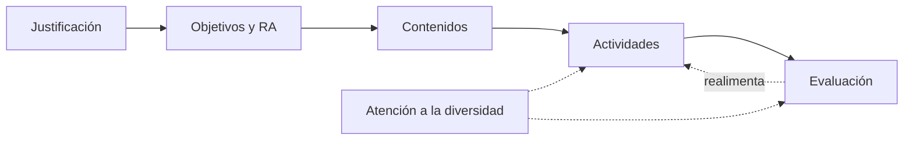

# 7. La unidad de programación

La **unidad de programación (UP)** es la concreción de la PD en el aula: un bloque de sesiones con unos objetivos, unos contenidos, unas actividades y una evaluación propios. Según la norma y la tradición recibe varios nombres: **unidad de trabajo (UT)** en FP, **unidad didáctica (UD)** y, en ESO y Bachillerato con la LOMLOE, **situación de aprendizaje (SA)**.

> [!IMPORTANT]
> En la oposición expondrás **una** de tus unidades, elegida entre **tres extraídas al azar** por ti. Por eso todas las unidades de tu PD tienen que estar pensadas como si fueran a salir.

## 7.1. Elementos de una unidad

| Elemento | Qué incluir |
|---|---|
| **Identificación** | Número y título, módulo, curso, horas, evaluación (trimestre) |
| **Justificación** | Por qué esta unidad: pedagógica y curricularmente. Ubicación dentro de la PD y relación con otras unidades y módulos |
| **Conexión curricular** | Objetivos generales del ciclo y competencias que trabaja; **RA y criterios de evaluación** del currículo que concreta |
| **Objetivos didácticos** | Capacidades evaluables, redactadas con verbos observables |
| **Contenidos** | Conceptos, procedimientos y actitudes. Contenidos transversales: igualdad, sostenibilidad, prevención de riesgos, TIC |
| **Temporalización y secuenciación** | Sesiones y su orden, coherentes con la tabla de la PD |
| **Metodología** | Estrategias de enseñanza-aprendizaje y agrupamientos |
| **Actividades** | De introducción y motivación, desarrollo, refuerzo, ampliación, evaluación, complementarias |
| **Recursos** | Materiales, espacios, *software*, recursos humanos, bibliografía |
| **Evaluación** | Criterios aplicados, instrumentos, ponderación, momento; evaluación de la práctica docente |
| **Atención a la diversidad** | Medidas concretas para el alumnado de esta unidad |

## 7.2. Cómo redactarla

1. **Parte del currículo.** Copia los RA y criterios que trabaja la unidad tal como están en el real decreto. No los reformules.
2. **Formula los objetivos didácticos** concretando esos criterios para tu contexto: *«Configurar el direccionamiento IP de los equipos del aula según un plan dado»*.
3. **Selecciona contenidos** a partir de los contenidos básicos del currículo.
4. **Diseña las actividades** en secuencia, con duración, agrupamiento y recursos de cada una. Que se vea el hilo: de la motivación al producto final.
5. **Diseña la evaluación**: qué criterio se evalúa en cada actividad, con qué instrumento y qué peso tiene.
6. **Añade las medidas de inclusión** pensando en alumnado concreto (el que describiste en el contexto de tu PD).

> [!TIP]
> Cuenta las horas: el tiempo de todas las actividades no puede superar las horas que la PD asigna a la unidad. El tribunal lo comprueba.

## 7.3. Ejemplo resumido

**UT 3 · Instalación y configuración de una red local** (módulo Redes locales, 1.º SMR, 18 h, 1.ª evaluación).

| | |
|---|---|
| **RA** | RA2: despliega el cableado de una red local interpretando especificaciones y aplicando técnicas de montaje, con sus criterios de evaluación |
| **Motivación** (1 h) | «El aula de informática del instituto se amplía: ¿qué necesitamos?». Lluvia de ideas y cuestionario inicial |
| **Desarrollo** (13 h) | Explicación con demostración del crimpado; práctica guiada de cableado; reto por equipos: diseñar y montar la red de un aula con presupuesto; documentación del montaje |
| **Refuerzo / ampliación** | Ficha paso a paso con imágenes / certificación del cableado con un comprobador y comparación de categorías |
| **Evaluación** (4 h) | Lista de cotejo del montaje (40 %), rúbrica del informe técnico (30 %), prueba práctica individual (30 %) |
| **Inclusión** | Instrucciones visuales, parejas heterogéneas, herramientas adaptadas si hay dificultades motrices |
| **Transversal** | Prevención de riesgos (herramientas de corte), reciclaje del material sobrante |

## 7.4. Taller en grupo

En la sesión de taller trabajarás en equipo sobre una unidad de un módulo común (por ejemplo, de Programación o de Bases de datos):

1. Ubicad la unidad en la PD y justificadla.
2. Conectad objetivos, RA, criterios y competencias.
3. Temporalizad y secuenciad las sesiones.
4. Diseñad las actividades, la evaluación y las medidas de inclusión.

Después, cada persona aplica lo aprendido a **su** unidad.


- q: "En la oposición, ¿cómo se elige la unidad que vas a exponer?"
  options: ["La elige el tribunal", "La eliges tú entre tres extraídas al azar", "Siempre es la primera de la PD"]
  answer: 1
  explain: "La persona aspirante extrae tres unidades al azar de su programación y elige una."
- q: "¿Puedes reformular los criterios de evaluación del real decreto con tus palabras?"
  options: ["Sí, para hacerlos más claros", "No; se copian del currículo y se concretan en los objetivos didácticos", "Solo en ESO"]
  answer: 1
  explain: "Los criterios son prescriptivos. La concreción se hace en los objetivos didácticos y en las actividades."


<!-- MATERIAL:inicio -->
## Material de la asignatura

### Guías y plantillas

- 
- 
- 
- 

### Ejemplos de unidades

- 
- 
- 
- **Ejemplos de UDs para la PD**
  - 
  - 
  - 
  - 
<!-- MATERIAL:fin -->
