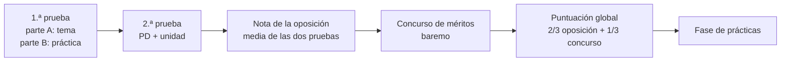

# 8. Oposiciones: especialidad 254 · Informática

En la Comunitat Valenciana, la especialidad **254 · Informática** pertenece al **cuerpo de profesorado de Enseñanza Secundaria (0590)**. Esta página resume cómo es el procedimiento de ingreso tomando como referencia la **última convocatoria, la Orden 1/2025, de 28 de enero** (modificada por la Orden 4/2025), y los **criterios de evaluación publicados por la comisión de selección** de Informática.

> [!WARNING]
> Cada convocatoria puede cambiar detalles (plazos, número de temas, formato). Lee siempre la **orden de la convocatoria del año** y los criterios que publica la comisión de selección de tu especialidad.

## 8.1. El concurso-oposición

- Las dos pruebas son **eliminatorias**: hay que sacar al menos un 5 en cada una.
- La nota de la fase de oposición es la **media aritmética** de las dos pruebas.
- Solo a quien supera la oposición se le suman los **méritos** (experiencia, formación, otros méritos). La puntuación global pondera **2/3 la oposición y 1/3 el concurso**.
- En 2025 se convocaron **60 plazas** de Informática (54 libres y 6 de reserva para personas con diversidad funcional).

## 8.2. Primera prueba (conocimientos de la especialidad)

| Parte | En qué consiste | Tiempo | Valor |
|---|---|:-:|:-:|
| **A** | Desarrollo por escrito de un tema elegido entre **4 sacados por sorteo** de los **74 temas** del temario | 2 h | 5 puntos |
| **B** | Prueba práctica con varios ejercicios o supuestos | hasta 4 h | 5 puntos |

Para superarla hay que sumar al menos 5 puntos y obtener en cada parte como mínimo el **25 %** de su valor. Las pruebas escritas son **anónimas** (etiquetas), con bolígrafo azul o negro, sin corrector.

### Criterios de la parte A (tema)

| Criterio | Peso |
|---|:-:|
| Estructura del tema: índice, introducción, desarrollo, conclusión, relación con el marco legal, bibliografía | 10 % |
| Expresión y presentación: claridad, corrección, vocabulario técnico, lenguaje inclusivo | 10 % |
| Conocimiento científico e innovación: profundidad, rigor, actualidad, inclusión, legislación, conclusión personal | 80 % |

### La parte B (práctica)

La comisión propone dos o más opciones de prueba práctica, desde un enfoque competencial y contextualizado, sobre ámbitos como: análisis y diseño de aplicaciones; programación estructurada y orientada a objetos; programación de servicios y procesos; desarrollo web cliente/servidor; aplicaciones multiplataforma; bases de datos relacionales (definición, manipulación, administración); sistemas multiusuario y en red; servicios de red e Internet; *software* libre y propietario; administración de una red local. Se valora la **estructura y presentación (5 %)** y el **contenido y la justificación didáctica (95 %)**: no basta con resolver; hay que relacionarlo con el currículo, el alumnado y la inclusión.

### El temario

El temario vigente de la especialidad es el aprobado por la **Orden de 1 de febrero de 1996** (BOE de 13 de febrero de 1996), con **74 temas**. En el material tienes también una propuesta de temario actualizado y un tema de ejemplo.

## 8.3. Segunda prueba (aptitud pedagógica)

Es la prueba para la que te prepara este bloque.

| | |
|---|---|
| **Qué se presenta** | Una **programación didáctica** de un módulo de FP o una **programación de aula** de ESO o Bachillerato, personal e individual, con la normativa vigente en la Comunitat Valenciana |
| **Cuándo se entrega** | Telemáticamente, en la sede electrónica de la Generalitat, en un único PDF de 25 MB como máximo |
| **Preparación** | **60 minutos** para preparar la unidad elegida, con el material que quieras pero sin conexión con el exterior |
| **Exposición** | Hasta **1 hora** en total: primero la **defensa de la programación (máximo 30 min)** y después la **exposición de la unidad**. Al final, el tribunal puede hacer preguntas |
| **Material en la exposición** | Un ejemplar de tu programación, material auxiliar y un **guion de un folio (dos caras)** que se entrega al tribunal |
| **Elección de la unidad** | Entre **tres extraídas al azar** de tu programación (o de tres temas del temario, si optas por esa vía) |

### Formato de la programación

| Requisito | |
|---|---|
| Extensión | Máximo **60 páginas** DIN-A4, sin contar portada, índice y anexos |
| Anexos | Máximo **15 páginas** |
| Letra e interlineado | **Arial 12**, sin comprimir, interlineado **1,5** (sencillo en tablas y gráficos) |
| Portada | Nombre y apellidos, DNI, cuerpo y especialidad |
| Enlaces | **Prohibidos** los hipervínculos |
| Unidades | Al menos **seis** desarrolladas |

Cada incumplimiento de formato resta **0,16 puntos** (hasta 1 punto). Si la programación supera las páginas permitidas, las que sobran no se valoran. Si el tribunal detecta que no es de elaboración propia, la nota de la prueba es **0**.

### Criterios de la segunda prueba (Informática, 2025)

| Criterio | Peso |
|---|:-:|
| Aspecto formal: cumple la convocatoria, normativa vigente, bibliografía | 5 % |
| Aspectos pedagógicos, didácticos, metodológicos y de evaluación | 25 % |
| Estructura y desarrollo de la unidad y respuestas al tribunal | 30 % |
| **Competencia comunicativa** | **40 %** |

> [!IMPORTANT]
> El **40 % de la nota** depende de **cómo comunicas**: fluidez, seguridad, organización del discurso, ejemplos, lenguaje corporal, uso del material y respuestas sin divagar. Por eso dedicamos diciembre a ensayar las exposiciones ([tema 9](/t09-defensa)).

### Ortografía y redacción

En todas las pruebas escritas y en la programación se descuentan: **0,25** por cada falta de grafía, **0,15** por cada tilde y **0,05** por cada error gramatical o de expresión (hasta 1 punto por parte en la primera prueba y hasta 2 en la programación).

## 8.4. Acceso a la docencia y otras salidas

- Para ser docente en la enseñanza pública o concertada necesitas el **máster de profesorado** (o la formación equivalente) además de la titulación.
- Las **bolsas de trabajo** de la Conselleria y la **oferta semanal de puestos de difícil cobertura** permiten trabajar como interino o interina.
- El Ministerio ofrece plazas de **profesorado visitante** y en centros españoles en el exterior.


- q: "¿Entre cuántos temas eliges en la parte A de la primera prueba?"
  options: ["2", "4", "5"]
  answer: 1
  explain: "En la convocatoria de 2025, para Informática se elige entre 4 temas sacados por sorteo de los 74 del temario."
- q: "¿Cuánto tiempo como máximo dura la defensa de la programación?"
  options: ["15 minutos", "30 minutos", "1 hora"]
  answer: 1
  explain: "La defensa de la programación no puede superar los 30 minutos; el conjunto con la unidad, una hora."
- q: "¿Qué criterio pesa más en la segunda prueba de Informática?"
  options: ["Aspecto formal", "Estructura y desarrollo", "Competencia comunicativa"]
  answer: 2
  explain: "La competencia comunicativa supone el 40 % de la nota de la segunda prueba."
- q: "¿Qué pasa si tu programación incluye enlaces?"
  options: ["Nada", "Se descuentan 0,16 puntos", "Se anula la prueba"]
  answer: 1
  explain: "La presencia de hipervínculos es un incumplimiento de formato que resta 0,16 puntos."


<!-- MATERIAL:inicio -->
## Material de la asignatura

### Convocatorias

- 
- [Oposiciones 2025](https://ceice.gva.es/es/web/rrhh-educacion/2025-cos-de-professors-d-ensenyament-secundari-ingres-i-noves-especialitats)
- 
- [Convocatòria oposicions professors d'Ensenyament Secundari](https://ceice.gva.es/va/web/rrhh-educacion/2020-cos-de-professors-d-ensenyament-secundari/-/asset_publisher/uI0q0NZkFnmI/content/convocato-11?redirect=https%3A%2F%2Fceice.gva.es%2Fca%2Fweb%2Frrhh-educacion%2F2020-cos-de-professors-d-ensenyament-secundari%3Fp_p_id%3D101_INSTANCE_uI0q0NZkFnmI%26p_p_lifecycle%3D0%26p_p_state%3Dnormal%26p_p_mode%3Dview%26p_p_col_id%3Dcolumn-2%26p_p_col_count%3D1)
- [CUERPO DE PROFESORES DE ENSEÑANZA SECUNDARIA (ESTABILITZACIÓN: CONCURSO OPOSICIÓN) 2023](https://ceice.gva.es/va/web/rrhh-educacion/2022-cos-professors-ensenyament-secundari/-/asset_publisher/XcFvFcwQzTfH/content/convocatoria-3-1?_com_liferay_asset_publisher_web_portlet_AssetPublisherPortlet_INSTANCE_XcFvFcwQzTfH_assetEntryId=369444586&_com_liferay_asset_publisher_web_portlet_AssetPublisherPortlet_INSTANCE_XcFvFcwQzTfH_redirect=https%3A%2F%2Fceice.gva.es%2Fca%2Fweb%2Frrhh-educacion%2F2022-cos-professors-ensenyament-secundari%3Fp_p_id%3Dcom_liferay_asset_publisher_web_portlet_AssetPublisherPortlet_INSTANCE_XcFvFcwQzTfH%26p_p_lifecycle%3D0%26p_p_state%3Dnormal%26p_p_mode%3Dview%26_com_liferay_asset_publisher_web_portlet_AssetPublisherPortlet_INSTANCE_XcFvFcwQzTfH_cur%3D0%26p_r_p_resetCur%3Dfalse%26_com_liferay_asset_publisher_web_portlet_AssetPublisherPortlet_INSTANCE_XcFvFcwQzTfH_assetEntryId%3D369444586)

### Criterios de evaluación de los tribunales

-  — Criterios de evaluación oposición 2025 informática
- **Criterios de evaluación de la oposición 2020**
  - 
  - 
  - 
  - 
- [Criterios de evaluación del proceso de estabilización 2022](https://ceice.gva.es/documents/162909733/372595656/254+cas_INFORM%C3%80TICA.pdf)
- **Documentación evaluación oposiciones**
  - 
  - 

### Temario de la especialidad

-  — Contenido del temario para las oposiciones de la especialidad de informática LOE
-  — Temario de la especialidad de Informática del año 1996.
-  — Tema muestra localizado en internet.

### Acceso a la función docente

- 
- **Recursos normativa acceso a la función docente**
  - 
- 
- [Oferta semanal de puestos de difícil cobertura](https://ceice.gva.es/es/web/rrhh-educacion/convocatoria-y-peticion-telematica6)
- [La educación en el exterior](https://aee.educacionfpydeportes.gob.es/inicio.html)
- [Convocatòria profesores visitantes 26-27](https://www.educacionfpydeportes.gob.es/dam/jcr:71219dac-452c-409e-8433-8d021908b0e4/anexo-2.pdf)
<!-- MATERIAL:fin -->
