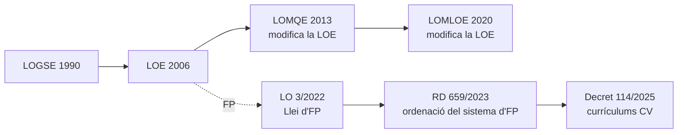

# 1. Sistema educatiu i marc legal

Tota programació comença pel **marc legal**: el tribunal espera que sàpies situar el teu mòdul o la teua matèria dins del sistema educatiu i citar amb precisió la normativa que el regula. En aquest tema repassem les lleis orgàniques d'educació i la nova ordenació de la Formació Professional.

## 1.1. Les lleis orgàniques d'educació

| Llei | Any | Situació |
|---|---|---|
| LOGSE (LO 1/1990) | 1990 | Derogada. Va crear l'ESO i els cicles formatius de grau mitjà i superior |
| LOE (LO 2/2006) | 2006 | **Vigent**, amb les modificacions de la LOMQE i la LOMLOE. Regula l'FP en els articles 39 a 44 |
| LOMQE (LO 8/2013) | 2013 | Va modificar la LOE; va crear l'FP Bàsica. Els seus canvis han sigut substituïts per la LOMLOE |
| LOMLOE (LO 3/2020) | 2020 | **Vigent**. Modifica la LOE: enfocament competencial, situacions d'aprenentatge, inclusió |
| LO 3/2022 d'FP | 2022 | **Vigent**. Llei d'ordenació i integració de la Formació Professional |

> [!TIP]
> Quan cites la llei d'educació, escriu *«Llei orgànica 2/2006, de 3 de maig, d'educació, modificada per la Llei orgànica 3/2020, de 29 de desembre (LOMLOE)»*. La LOMLOE no és una llei independent: modifica la LOE.

## 1.2. La nova Formació Professional

La **Llei orgànica 3/2022, de 31 de març**, crea un **sistema únic de Formació Professional** que integra l'FP del sistema educatiu i l'FP per a l'ocupació. La desplega el **Reial decret 659/2023, de 18 de juliol**, pel qual es desplega l'ordenació del Sistema de Formació Professional.

### Els graus de l'oferta d'FP

| Grau | Oferta | Acreditació |
|---|---|---|
| A | Acreditació parcial de competència | Acreditació parcial |
| B | Certificat de competència | Certificat de competència |
| C | Certificat professional | Certificat professional |
| **D** | **Cicles formatius** (bàsic, mitjà i superior) | **Títol** de Tècnic Bàsic, Tècnic o Tècnic Superior |
| E | Cursos d'especialització | Títol d'Especialista o Màster Professional |

Com a professorat d'Informàtica impartiràs sobretot en el **grau D** (cicles formatius) i en el **grau E** (cursos d'especialització, per exemple de ciberseguretat o d'intel·ligència artificial i *big data*).

### Caràcter dual i formació en empresa

Tota l'FP té ara **caràcter dual**: una part de la formació es fa en l'empresa (FE, formació en empresa o organisme equiparat), que substitueix l'antiga FCT. El Decret 114/2025 de la Comunitat Valenciana estableix dos règims:

| Règim | Durada de la FE | Resultats d'aprenentatge en l'empresa |
|---|---|---|
| **General** | Entre el 25 % i el 35 % de la durada total del cicle | Almenys el 10 % dels RA |
| **Intensiu** | Com a mínim el 35 % | Almenys el 30 % dels RA (amb autorització) |

La FE **no té currículum propi**: contribueix a assolir part dels resultats d'aprenentatge dels mòduls. Per això la teua programació ha d'indicar **quins RA es treballen en l'empresa**.

> [!IMPORTANT]
> Per a començar la FE, l'alumnat ha d'haver adquirit abans les competències de **prevenció de riscos laborals** del perfil, que se situen obligatòriament en el primer trimestre del primer curs.

### Els mòduls dels nous cicles

A més dels mòduls tècnics de cada títol, tots els cicles inclouen:

- **Itinerari personal per a l'ocupabilitat I i II** (substitueixen FOL i EIE).
- **Digitalització aplicada al sistema productiu**.
- **Sostenibilitat aplicada al sistema productiu**.
- **Anglés professional**.
- **Projecte intermodular**, basat preferentment en reptes.
- Un **mòdul optatiu** en segon curs.

## 1.3. Normativa de la Comunitat Valenciana

| Norma | Què regula |
|---|---|
| **Decret 114/2025, de 29 de juliol** | Currículums dels cicles de grau mitjà i superior en aplicació de la LO 3/2022. Projecte curricular de cicle (art. 8) i **programació didàctica de mòdul** (art. 9) |
| Resolució d'inici de curs | Instruccions anuals d'organització dels centres que imparteixen FP |
| Ordre 79/2010 | Avaluació de l'alumnat d'FP ([tema 5](/t05-evaluacion)) |
| Decret 104/2018 i Ordre 20/2019 | Inclusió educativa ([tema 6](/t06-inclusion)) |

> [!WARNING]
> La normativa d'FP ha canviat molt des de 2022 i continua canviant. Abans de citar una norma en la teua PD, comprova en el BOE o el DOGV que continua vigent i consulta'n la **versió consolidada**. La convocatòria exigeix programar amb la normativa vigent en el curs de referència.

## 1.4. Autonomia pedagògica dels centres

La LOE (article 120 i següents) reconeix l'**autonomia pedagògica, d'organització i de gestió** dels centres. Aquesta autonomia és la que justifica que tu, com a docent, concretes el currículum en la teua programació, adaptant-lo al context del centre i a l'alumnat ([tema 3](/t03-programacion-didactica)).

## Repàs


- t: "LOMLOE"
  d: "Llei orgànica 3/2020, que modifica la LOE de 2006. No la substitueix."
- t: "LO 3/2022"
  d: "Llei d'ordenació i integració de la Formació Professional."
- t: "RD 659/2023"
  d: "Reial decret que desplega l'ordenació del Sistema d'FP."
- t: "Grau D"
  d: "Cicles formatius: bàsic, mitjà i superior."
- t: "FE"
  d: "Formació en empresa o organisme equiparat. Substitueix la FCT."
- t: "Decret 114/2025"
  d: "Currículums dels cicles de grau mitjà i superior a la Comunitat Valenciana."



- q: "Quina llei orgànica d'educació està vigent?"
  options: ["La LOMLOE, que va substituir la LOE", "La LOE, modificada per la LOMLOE", "La LOMQE"]
  answer: 1
  explain: "La LOMLOE (LO 3/2020) és una llei de modificació: la llei vigent continua sent la LOE de 2006 amb les seues modificacions."
- q: "En el règim general d'FP dual, la formació en empresa dura…"
  options: ["Menys del 25 % del cicle", "Entre el 25 % i el 35 % del cicle", "Més del 50 % del cicle"]
  answer: 1
  explain: "El règim general va del 25 % al 35 % de la durada total; l'intensiu, a partir del 35 %."
- q: "En quin grau del sistema d'FP hi ha els cursos d'especialització?"
  options: ["Grau C", "Grau D", "Grau E"]
  answer: 2
  explain: "El grau D són els cicles formatius i el grau E els cursos d'especialització."
- q: "Quin article del Decret 114/2025 regula la programació didàctica de mòdul?"
  options: ["Article 5", "Article 9", "Article 12"]
  answer: 1
  explain: "L'article 9 enumera els apartats que ha d'incloure la programació didàctica d'un mòdul professional."


<!-- MATERIAL:inicio -->
## Material de l'assignatura

### Lleis orgàniques d'educació

-  — Llei Orgànica d'Educació 2/2006, de 3 de maig de 2006
- [LOE](https://www.boe.es/buscar/pdf/2006/BOE-A-2006-7899-consolidado.pdf)
-  — Ley Orgánica 8/2013, de 9 de diciembre, para la mejora de la calidad educativa.
- 
- [Los efectos de la LOMCE en la FP](https://raulsolbes.com/2016/04/13/los-efectos-de-la-lomce-en-la-fp/)
-  — Esquema del sistema educatiu espanyol segons la Llei Orgànica de Millora de la Qualitat Educativa (LOMQE)

### Formació Professional: llei i desplegament

- 
- [LFP](https://www.educacionfpydeportes.gob.es/destacados/nueva-ley-fp.html#:~:text=La%20Ley%20Org%C3%A1nica%20de%20Ordenaci%C3%B3n,23%20de%20marzo%20de%202022.)
- [Dossier LFP](https://www.todofp.es/dam/jcr:99d1f05d-2db7-4898-89f8-faec6f3e76af/dossier-informativo-nueva-ley-fp-2022.pdf)
- 
- 
-  — Real Decreto 659/2023, de 18 de julio, por el que se desarrolla la ordenación del Sistema de Formación Profesional. de la ordenación y organización académica de los ciclos formativos de Formación Profesional del sistema educativo en el ámbito territorial de la Comunitat Valenciana. [2010/9539]
- 
- [Orden de Inicio de curso](https://ceice.gva.es/documents/388109149/394550702/Instrucciones+2025-26+DOGV+cas_firmado.pdf/943f8061-3f8d-6a4c-21fe-d0a0b5478c75?t=1752748668357)

### Gestió de la FP a la Comunitat Valenciana

- 
- 
- 
- 
<!-- MATERIAL:fin -->
