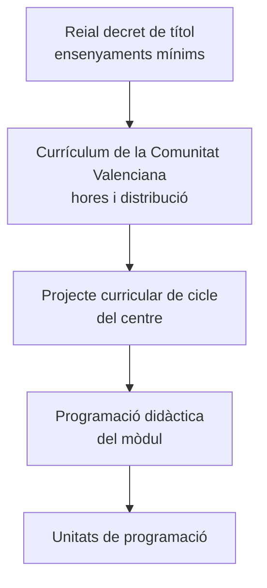

# 2. Els ensenyaments d'informàtica: títols i currículums

L'especialitat **254 · Informàtica** del cos de professorat d'Ensenyament Secundari té atribució docent en la **Formació Professional** de la família d'Informàtica i Comunicacions i en matèries d'**ESO i Batxillerat** relacionades amb la informàtica i la digitalització. Abans de programar has de saber **on està escrit el que ensenyaràs**.

## 2.1. Dos nivells de normativa: títol i currículum

En FP sempre hi ha dues normes per a cada cicle:

| Norma | Qui la dicta | Què conté |
|---|---|---|
| **Reial decret de títol** | Ministeri | Perfil professional, competències, mòduls, **resultats d'aprenentatge i criteris d'avaluació**, continguts bàsics, orientacions pedagògiques i ensenyaments mínims |
| **Currículum autonòmic** | Conselleria | Completa el títol per a la Comunitat Valenciana: hores de cada mòdul, distribució per cursos i continguts ampliats |

## 2.2. Els títols de la família d'Informàtica i Comunicacions

| Cicle | Grau | Títol | Reial decret |
|---|---|---|---|
| **SMR** | Mitjà | Tècnic en Sistemes Microinformàtics i Xarxes | RD 1691/2007 |
| **ASIR** | Superior | Tècnic Superior en Administració de Sistemes Informàtics en Xarxa | RD 1629/2009 |
| **DAM** | Superior | Tècnic Superior en Desenvolupament d'Aplicacions Multiplataforma | RD 450/2010 |
| **DAW** | Superior | Tècnic Superior en Desenvolupament d'Aplicacions Web | RD 686/2010 |

La família inclou també l'**FP Bàsica** (Informàtica i Comunicacions, Informàtica d'Oficina) i **cursos d'especialització** com Ciberseguretat en Entorns de les Tecnologies de la Informació, Intel·ligència Artificial i *Big Data* o Desenvolupament de Videojocs i Realitat Virtual.

> [!IMPORTANT]
> Aquests reials decrets s'han **modificat** després de publicar-se (per exemple, el RD 405/2023 va actualitzar DAM i DAW, i el RD 499/2024 i el RD 500/2024 van incorporar els nous mòduls comuns). En la teua PD cita el reial decret original **i** les seues modificacions, i copia els RA i criteris de la **versió consolidada**.

### Com llegir un reial decret de títol

1. **Article de perfil professional:** competència general, competències professionals, personals i socials, i qualificacions professionals incloses.
2. **Objectius generals** del cicle (les lletres a, b, c… que citaràs en la teua PD).
3. **Annex I · Mòduls professionals:** per a cada mòdul, els **resultats d'aprenentatge** amb els **criteris d'avaluació**, la **durada**, els **continguts bàsics** i les **orientacions pedagògiques**, on es diu quins objectius generals i competències treballa el mòdul i quines línies d'actuació es recomanen.

> [!TIP]
> Les orientacions pedagògiques del mòdul són or per a la teua PD: et donen la **justificació** del mòdul i la relació amb els objectius generals i les competències del títol.

## 2.3. Els currículums de la Comunitat Valenciana

La Conselleria publica un currículum per a cada cicle (en la carpeta de material tens els d'SMR, ASIR, DAM i DAW). Des del curs 2025/26, el **Decret 114/2025** estableix els currículums dels cicles de grau mitjà i superior adaptats a la LO 3/2022. Fixa't en:

- la **càrrega horària** de cada mòdul a la Comunitat Valenciana, que és la que has d'usar per a temporitzar;
- la distribució dels mòduls entre **primer i segon curs**;
- els mòduls nous (Itinerari per a l'ocupabilitat, Digitalització, Sostenibilitat, Anglés professional, Projecte intermodular i optativa).

## 2.4. ESO i Batxillerat

En ESO i Batxillerat la referència és el **currículum LOMLOE**: competències clau, competències específiques, criteris d'avaluació i sabers bàsics, que es treballen mitjançant **situacions d'aprenentatge**.

| Etapa | Norma estatal | Norma de la Comunitat Valenciana |
|---|---|---|
| ESO | RD 217/2022, de 29 de març | Decret 107/2022, de 5 d'agost |
| Batxillerat | RD 243/2022, de 5 d'abril | Decret 108/2022, de 5 d'agost |

Les matèries més habituals per a l'especialitat són les de **Digitalització** i les de **Tecnologia i Enginyeria** compartides amb altres especialitats, a més de les optatives pròpies de la Comunitat Valenciana. Revisa l'annex del decret per a comprovar l'atribució docent de cada matèria.

## 2.5. Activitat: compara currículums

Tria un cicle de la família i compara el **currículum del Ministeri** (aplicable en el territori que gestiona directament) amb el de la **Comunitat Valenciana**:

1. Quins mòduls i quantes hores té cadascun? En quin curs s'imparteixen?
2. Tria un mòdul i compara'n els continguts: què s'hi ha afegit o concretat a la Comunitat Valenciana?
3. Què canvia amb la incorporació dels nous mòduls de la LO 3/2022?


- q: "On hi ha els resultats d'aprenentatge i els criteris d'avaluació d'un mòdul d'FP?"
  options: ["En l'ordre d'avaluació de la Comunitat Valenciana", "En el reial decret del títol (annex I)", "En la programació del departament"]
  answer: 1
  explain: "Els RA i els criteris d'avaluació són ensenyaments mínims i els fixa el reial decret de títol, en l'annex I."
- q: "Quines hores uses per a temporitzar un mòdul en un institut d'Alacant?"
  options: ["Les del reial decret de títol", "Les del currículum de la Comunitat Valenciana", "Les que decidisca el departament"]
  answer: 1
  explain: "El reial decret fixa les hores mínimes; la càrrega lectiva real a la Comunitat Valenciana la fixa el seu currículum."
- q: "En ESO, com s'organitzen els aprenentatges segons la LOMLOE?"
  options: ["En unitats de treball", "En situacions d'aprenentatge", "En resultats d'aprenentatge"]
  answer: 1
  explain: "En ESO i Batxillerat la programació d'aula es desenvolupa mitjançant situacions d'aprenentatge."


<!-- MATERIAL:inicio -->
## Material de l'assignatura

### Reials decrets de títol

-  — REAL DECRETO 1691/2007, de 14 de diciembre, por el que se establece el título de Técnico en Sistemas Microinformáticos y Redes y se fijan sus enseñanzas mínimas.
-  — Real Decreto 1629/2009, de 30 de octubre, por el que se establece el título de Técnico Superior en Administración de Sistemas Informáticos en Red y se fijan sus enseñanzas mínimas.
-  — Real Decreto 450/2010, de 16 de abril, por el que se establece el título de Técnico Superior en Desarrollo de Aplicaciones Multiplataforma y se fijan sus enseñanzas mínimas.
-  — Real Decreto 686/2010, de 20 de mayo, por el que se establece el título de Técnico Superior en Desarrollo de Aplicaciones Web y se fijan sus enseñanzas mínimas.

### Currículums de la Comunitat Valenciana i oferta

- 
- 
- 
- 
- [Oferta Ciclos de Informática en la Comunitat Valencianana](http://www.ceice.gva.es/web/formacion-profesional/oferta1)
- [Oferta Cursos Especialización a la Comunitat Valencianana](https://ceice.gva.es/es/web/formacion-profesional/dossier-de-cursos-d-especialitzacio)

### Ordenació de la FP

-  — Reial Decret 1147/2011, de 29 de juliol, per el que s'estableix l'ordenació general de la formació professional del sistema educatiu.
-  — ORDEN 46/2012, de 12 de julio, de la Conselleria de Educación, Formación y Empleo, por la que se regulan determinados aspectos de la ordenación de la Formación Profesional del sistema educativo en la Comunitat Valenciana.
- 
-  — Consideraciones a tener en cuenta en torno a la calificación del módulo profesional "Inglés técnico/Horario reservado para la docencia en inglés"

### ESO i Batxillerat

-  — Real Decreto 217/2022, de 29 de marzo, por el que se establece la ordenación y las enseñanzas mínimas de la Educación Secundaria Obligatoria del Ministerio de Educación y Formación Profesional
- [Enlace a curriculums ESO_Bachillerato Comunidad Valenciana](http://www.ceice.gva.es/es/web/ordenacion-academica/curriculo-eso-bachillerato-por-materias)
- [Curriculo BACH 2022](https://dogv.gva.es/datos/2022/08/12/pdf/2022_7578.pdf)
- [Enlace normativa referente a la ESO en la Comunidad Valenciana](http://www.ceice.gva.es/va/web/ordenacion-academica/secundaria/curriculo)
- 
- [Enlace documentos puente de la ESO en la Comunitat Valenciana](http://mestreacasa.gva.es/web/formaciodelprofessorat/dpsecundaria) — El enlace indicado esta referido al documento puente de secundaria para la planificación de la programación didáctica.
- [Curriculos Básicos por Enseñanzas LOMLOE](https://educagob.educacionfpydeportes.gob.es/eu/curriculo/curriculo-lomloe/menu-curriculos-basicos.html)
- [Curriculos LOMLOE](https://educagob.educacionfpydeportes.gob.es/curriculo/curriculo-lomloe/curriculos-ccaa.html)
- [Nuevo Curriculum](https://portal.edu.gva.es/noucurriculum/)
- [Curriculum LOMLOE](https://www.aprendecondanio.com/blog/lomloe/competencias-clave-saberes-basicos/)

### Per a llegir i reflexionar

- 
-  — Informe presentado por SCIE (Sociedad Científica Informática de España) y CODDII (Conferencia de Directores y Decanos de Ingeniería Informática) sobre la enseñanza preuniversitaria de la informática
<!-- MATERIAL:fin -->
