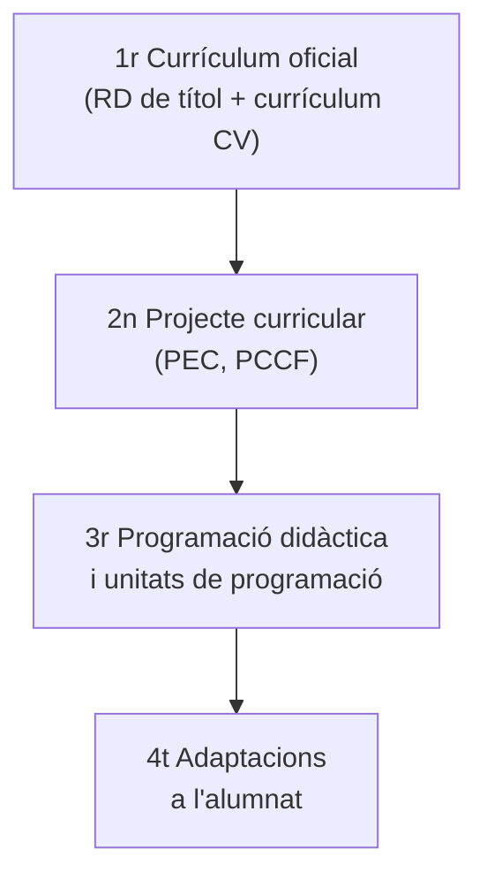

# 3. La programació didàctica

La **programació didàctica (PD)** és el document en què planifiques un curs complet d'un mòdul o una matèria: què ensenyaràs, en quin ordre, com i com ho avaluaràs, adaptat a un centre i a un grup concrets. En l'oposició és, a més, **el document que defenses davant del tribunal**.

## 3.1. Els nivells de concreció curricular

La PD no s'inventa: concreta el que ja fixen les normes de rang superior.

| Nivell | Document | Qui l'elabora |
|---|---|---|
| **1r** | Reial decret de títol o d'ensenyaments mínims i currículum autonòmic | Ministeri i Conselleria |
| **2n** | Projecte educatiu de centre (PEC) i **projecte curricular de cicle** (PCCF) o d'etapa | Centre i equips docents |
| **3r** | **Programació didàctica** i unitats de programació | Departament i professorat |
| **4t** | Adaptacions per a grups o alumnat concret | Professorat, amb el suport del departament d'orientació |

### Els documents de centre

La teua PD ha de ser coherent amb els documents del centre en què la situes. Els més importants són el **projecte educatiu (PEC)**, la **programació general anual (PGA)**, el **pla d'acció tutorial**, el **pla d'igualtat i convivència**, el **pla de transició** i el **pla de foment de la lectura**. En el material tens els d'un institut real com a model.

## 3.2. Què ha de contindre: el Decret 114/2025

L'**article 9 del Decret 114/2025** estableix que la programació didàctica d'un mòdul professional l'elabora el departament, tenint en compte el projecte curricular, i inclou:

1. Dades identificatives, marc normatiu i contextualització del mòdul.
2. Relació entre els estàndards de competència i els mòduls del cicle formatiu.
3. Contribució dels resultats d'aprenentatge a les competències generals.
4. Esquema general i seqüenciació de les **unitats de programació**.
5. Metodologia del procés d'ensenyament-aprenentatge.
6. Recursos.
7. Ús d'espais i equipaments.
8. Mesures d'atenció a la diversitat.
9. Avaluació de l'aprenentatge.
10. Activitats complementàries i extraescolars.
11. Criteris i procediments per a avaluar el desenvolupament de la programació i la pràctica docent, i criteris de qualificació.

## 3.3. Què demana la convocatòria d'oposicions

La convocatòria de 2025 (Ordre 1/2025) exigeix, per a les especialitats d'FP, que la PD **especifique i interrelacione**:

- objectius (si el títol és LOGSE), competència professional i unitats de competència del mòdul;
- els **resultats d'aprenentatge** i la seua **distribució entre el centre i la formació en empresa**;
- criteris d'avaluació i continguts;
- metodologia, inclòs l'ús de les TIC;
- connexions amb altres mòduls professionals;
- distribució temporal i agrupament de l'alumnat;
- mesures i suports per a l'atenció a tot l'alumnat en un sistema educatiu inclusiu.

A més, ha de tindre **almenys sis unitats de programació desenvolupades**; si no les té, la prova queda invalidada. No es poden programar els mòduls optatius, el projecte intermodular, Sostenibilitat, Digitalització ni Itinerari personal per a l'ocupabilitat II.

> [!NOTE]
> En **ESO i Batxillerat** es presenta una **programació d'aula** d'un curs, amb enfocament competencial i **almenys sis situacions d'aprenentatge desenvolupades** (article 22 del Decret 107/2022 i article 23 del Decret 108/2022).

## 3.4. Una estructura que funciona

Aquesta és una distribució orientativa de les 60 pàgines, que pots adaptar a la convocatòria de l'any:

| Apartat | Contingut | Pàg. |
|---|---|:-:|
| **1. Introducció** | Justificació, nivells de concreció, entorn del centre, característiques de l'alumnat, marc legal | 8 |
| **2. Objectius i competències** | Objectius generals del cicle, competències del mòdul, resultats d'aprenentatge | 4 |
| **3. Continguts** | Estructura del currículum, relació d'unitats de programació, continguts transversals, temporització i seqüenciació | 20 |
| **4. Metodologia** | Principis metodològics, estratègies, tipus d'activitats, materials i recursos, organització de l'aula | 8 |
| **5. Avaluació** | Criteris, procediments i instruments, qualificació, recuperació, avaluació de la pràctica docent | 12 |
| **6. Ús de les TIC** | Eines i programari del mòdul, cerca d'informació | 2 |
| **7. Atenció a la diversitat** | Mesures de resposta per a la inclusió | 4 |
| **8. Formació en empresa** | RA i continguts que es treballen en l'empresa | 1 |
| **9. Bibliografia i legislació** | Referències actualitzades | 1 |

Pots afegir activitats complementàries i extraescolars i annexos (com a màxim 15 pàgines: rúbriques, models d'avaluació, plantilles).

## 3.5. Temporització i seqüenciació

Una bona PD demostra que el temps **quadra**:

1. Parteix de la **càrrega horària del mòdul** en el currículum de la Comunitat Valenciana i de les hores setmanals.
2. Situa el curs en el **calendari escolar** (festius, avaluacions i període de formació en empresa).
3. Reparteix les hores entre les unitats de programació i comprova que **la suma coincideix** amb el total.
4. Justifica l'**ordre**: del general al particular, del senzill al complex, seguint el procés de treball real o coordinant-te amb altres mòduls.

> [!TIP]
> Inclou una **taula de doble entrada** que relacione cada unitat de programació amb els RA i criteris que treballa. És la manera més ràpida de demostrar al tribunal que cobreixes tot el currículum.

## 3.6. Com redactar els objectius

Els objectius i els criteris es redacten amb **un verb en infinitiu** que expresse una acció observable i avaluable: *identificar, descriure, configurar, instal·lar, desenvolupar, documentar, verificar…* Evita verbs com *saber*, *entendre* o *conéixer*, que no es poden observar. En el material tens una relació de verbs segons el tipus de contingut.

## 3.7. Activitat del taller

Durant els tallers de novembre redactaràs la teua PD per parts:

- **Taller I:** introducció (justificació, context, marc legal), objectius, competències, RA i continguts.
- **Taller II:** relació d'unitats, temporització, metodologia, avaluació, atenció a la diversitat, recursos, TIC, activitats complementàries i FE.


- q: "En quin nivell de concreció curricular hi ha la programació didàctica?"
  options: ["Primer", "Segon", "Tercer"]
  answer: 2
  explain: "El primer nivell és el currículum oficial; el segon, el projecte curricular del centre; el tercer, la programació didàctica."
- q: "Quantes unitats de programació desenvolupades exigeix com a mínim la convocatòria de 2025?"
  options: ["Sis", "Deu", "Quinze"]
  answer: 0
  explain: "Si la PD no conté almenys sis unitats de programació desenvolupades, la prova queda invalidada."
- q: "Quin d'aquests mòduls NO es pot triar per a la PD en la convocatòria de 2025?"
  options: ["Bases de dades", "Projecte intermodular", "Serveis en xarxa"]
  answer: 1
  explain: "Queden exclosos els optatius, el projecte intermodular, Sostenibilitat, Digitalització i Itinerari personal per a l'ocupabilitat II."


<!-- MATERIAL:inicio -->
## Material de l'assignatura

### Guies i plantilles

- 
- 
- 
- **Orientacions, verbs i exemples d'UT**
  - 
  - 
  - 
  - 
  - 
  - 
  - 
  - 
  - 
- 
- 

### Documents de centre

- **Documentos de Centro**
  - 
  - 
  - 
  - 
  - 
  - 
  - 
-  — Modelo de PD, utilizado en el IES Cavanilles, indicando los contenidos y formato que deben tener para los diferentes módulos de Formación Profesional.

### Exemples de programacions de FP

- **Ejemplos Programaciones** — Ejemplos de una Programación Didáctica y una Unidad de Trabajo, que sirva como modelo del producto final a redactar por parte del alumnado de la asignatura.
  - 
  - 
  - 
  - 
  - 
  - 
  - 
  - 
  - 
  - 
  - 
  - 
- 
- 
- 

### Exemples de programacions d'ESO

- **Ejemplos de programaciones ESO**
  - 
  - 
  - 
  - 
  - 
  - 
  - 
- 

### Vídeos

- [Tecnológicas para diseñar experiencias educativas en FP](https://youtu.be/tiO1vndaT8o)
- [Infografía y visualización de datos para enseñanza-aprendizaje y difusión de la innovación](https://youtu.be/4hP7Q4LZWe8)
<!-- MATERIAL:fin -->
