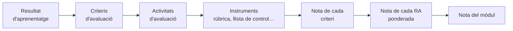

# 5. Avaluació

L'avaluació és l'apartat de la PD que més preguntes genera en el tribunal. Has de demostrar que saps **què** avalues (resultats d'aprenentatge i criteris), **com** ho avalues (tècniques i instruments), **quan** (inicial, contínua i final) i **com qualifiques**.

## 5.1. Normativa

| Norma | Àmbit |
|---|---|
| **RD 984/2021**, de 16 de novembre | Avaluació, promoció i titulació en Primària, ESO, Batxillerat i FP (estatal) |
| **RD 659/2023** | Avaluació en el nou sistema d'FP |
| **Ordre 79/2010**, de 27 d'agost | Avaluació de l'alumnat dels cicles formatius a la Comunitat Valenciana |
| **Ordre 38/2017**, de 4 d'octubre | Avaluació en ESO, Batxillerat i persones adultes a la Comunitat Valenciana (revisa la normativa LOMLOE que la substitueix o modifica) |
| Resolució anual d'inici de curs | Calendari d'avaluacions i detalls organitzatius |

> [!WARNING]
> En la PD **cita sempre la norma** quan descrigues el teu sistema d'avaluació: *«D'acord amb el que estableix l'Ordre 79/2010…»*. Comprova abans que continua vigent i si ha sigut modificada.

## 5.2. Característiques de l'avaluació en FP

- **Contínua:** es recull informació al llarg de tot el procés, no només al final.
- **Formativa:** servix per a millorar l'aprenentatge i l'ensenyament mentre ocorren.
- **Criterial:** el referent són els **resultats d'aprenentatge** i els seus **criteris d'avaluació**, no la comparació amb la resta del grup.
- **Per mòduls:** cada mòdul s'avalua i es qualifica per separat, tenint en compte la competència general del títol.
- **Integradora** en l'equip docent, especialment amb la formació en empresa i el projecte intermodular.

### Moments

| Moment | Per a què | Exemples |
|---|---|---|
| **Inicial** | Conéixer el punt de partida | Qüestionari, prova pràctica senzilla, enquesta d'interessos |
| **Contínua o formativa** | Seguir el progrés i ajustar | Pràctiques, observació, qüestionaris, portafolis |
| **Final o sumativa** | Qualificar l'assoliment dels RA | Proves, projecte final, rúbriques de cada RA |

## 5.3. Del criteri a la nota

1. Assigna a cada **resultat d'aprenentatge** un **pes** en la nota del mòdul, en funció de les hores i la seua importància.
2. Per a cada RA, pondera els seus **criteris d'avaluació**.
3. Associa cada criteri a una o diverses **activitats d'avaluació** i a un **instrument** concret.
4. La nota del mòdul és la **mitjana ponderada** dels RA. Explica què passa si un RA no se supera.

> [!TIP]
> Una taula **RA – pes – criteris – unitat – instrument** en la PD (o en un annex) resol d'un colp d'ull la pregunta clàssica del tribunal: *«com qualifiques el mòdul?»*.

## 5.4. Tècniques, procediments i instruments

- **Tècnica o procediment:** el *com* es recull la informació (observació, anàlisi de produccions, proves, entrevistes, autoavaluació, coavaluació).
- **Instrument:** l'eina concreta on es registra (rúbrica, llista de control, escala de valoració, diari del professorat, prova escrita o pràctica, portafolis, qüestionari).

| Instrument | Usa'l per a… |
|---|---|
| **Rúbrica** | Productes complexos: projectes, exposicions, informes tècnics |
| **Llista de control** | Comprovar si es compleix un procediment: «configura la IP», «documenta el codi» |
| **Escala de valoració** | Graus d'assoliment d'actituds o destreses |
| **Prova pràctica** | Resoldre un supòsit en l'equip: instal·lar, configurar, programar |
| **Prova escrita** | Conceptes i raonament |
| **Portafolis** | Evolució de l'alumnat al llarg del curs |

### Les rúbriques

Una rúbrica és una matriu amb **criteris** (files), **nivells d'assoliment** (columnes) i **descriptors** que expliquen què s'observa en cada nivell. Les bones rúbriques tenen descriptors observables, nivells ben diferenciats i una ponderació clara. **Comparteix-les amb l'alumnat abans de la tasca**: així també servixen per a aprendre.

## 5.5. Recuperació i avaluació de la pràctica docent

- Descriu les **activitats de recuperació**, el **pla de treball** per a l'alumnat amb RA pendents i les convocatòries ordinària i extraordinària.
- Inclou l'**avaluació del procés d'ensenyament**: autoavaluació del professorat, enquestes a l'alumnat, revisió en el departament i propostes de millora.


- q: "Quin és el referent de l'avaluació en un mòdul d'FP?"
  options: ["La mitjana del grup", "Els resultats d'aprenentatge i els seus criteris", "Els continguts del llibre de text"]
  answer: 1
  explain: "L'avaluació és criterial: es valora l'assoliment dels RA a través dels seus criteris d'avaluació."
- q: "Una llista de control és…"
  options: ["Una tècnica", "Un instrument", "Un criteri d'avaluació"]
  answer: 1
  explain: "La tècnica és la manera de recollir informació (per exemple, l'observació); la llista de control és l'instrument on es registra."
- q: "Quina norma regula l'avaluació de l'alumnat d'FP a la Comunitat Valenciana?"
  options: ["Ordre 79/2010", "Ordre 20/2019", "Decret 104/2018"]
  answer: 0
  explain: "L'Ordre 79/2010 regula l'avaluació en els cicles formatius. L'Ordre 20/2019 i el Decret 104/2018 tracten la inclusió."


<!-- MATERIAL:inicio -->
## Material de l'assignatura

### Normativa

-  — Real Decreto 984/2021, de 16 de noviembre, por el que se regulan la evaluación y la promoción en la Educación Primaria, así como la evaluación, la promoción y la titulación en la Educación Secundaria Obligatoria, el Bachillerato y la Formación Profesional.
- 
-  — ORDEN 38/2017, de 4 de octubre, de la Conselleria de Educación, Investigación, Cultura y Deporte, por la que se regula la evaluación en Educación Secundaria Obligatoria, en Bachillerato y en las enseñanzas de la Educación de las Personas Adultas en la Comunitat Valenciana.
-  — ORDEN 79/2010, de 27 de agosto, de la Conselleria de Educación, por la que se regula la evaluación del alumnado de los ciclos formativos de Formación Profesional del sistema educativo en el ámbito territorial de la Comunitat Valenciana. [2010/9553]
-  — Se describen las relaciones entre las competencias, los contenidos y los criterios de evaluación de la educación primaria, la educación secundaria obligatoria y el bachillerato.
- [Ordenación Legislativa Evaluación](https://ceice.gva.es/es/web/formacion-profesional/normativa-sobre-ordenacion-y-organizacion-academica-de-los-ciclos-formativos)

### Planificar l'avaluació

- 
- 
-  — Guía de apoyo para la redacción, puesta en práctica y evaluación de los Resusltados de Aprendizaje.
- 
- 

### Tècniques i instruments

- 
- 
- 
- [Instrumentos y Técnicas de EVALUACIÓN](https://www.youtube.com/watch?v=n5SM_Pzoiw0)
- [Scape Room](https://view.genially.com/67162f848ba3be8e9bed2e27/interactive-content-escape-room-evaluacion)

### Rúbriques

- 
- [Video Rúbricas I](https://www.youtube.com/watch?v=ycIeZOr9z24)
- [Video Rubricas II](https://www.youtube.com/watch?v=UTeiNh6SlyM)
- 
- 
- 
<!-- MATERIAL:fin -->
