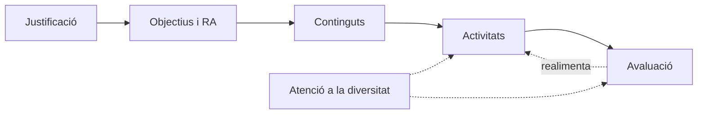

# 7. La unitat de programació

La **unitat de programació (UP)** és la concreció de la PD en l'aula: un bloc de sessions amb uns objectius, uns continguts, unes activitats i una avaluació propis. Segons la norma i la tradició rep diversos noms: **unitat de treball (UT)** en FP, **unitat didàctica (UD)** i, en ESO i Batxillerat amb la LOMLOE, **situació d'aprenentatge (SA)**.

> [!IMPORTANT]
> En l'oposició exposaràs **una** de les teues unitats, triada entre **tres extretes a l'atzar** per tu. Per això totes les unitats de la teua PD han d'estar pensades com si hagueren d'eixir.

## 7.1. Elements d'una unitat

| Element | Què cal incloure |
|---|---|
| **Identificació** | Número i títol, mòdul, curs, hores, avaluació (trimestre) |
| **Justificació** | Per què aquesta unitat: pedagògicament i curricularment. Ubicació dins de la PD i relació amb altres unitats i mòduls |
| **Connexió curricular** | Objectius generals del cicle i competències que treballa; **RA i criteris d'avaluació** del currículum que concreta |
| **Objectius didàctics** | Capacitats avaluables, redactades amb verbs observables |
| **Continguts** | Conceptes, procediments i actituds. Continguts transversals: igualtat, sostenibilitat, prevenció de riscos, TIC |
| **Temporització i seqüenciació** | Sessions i el seu ordre, coherents amb la taula de la PD |
| **Metodologia** | Estratègies d'ensenyament-aprenentatge i agrupaments |
| **Activitats** | D'introducció i motivació, desenvolupament, reforç, ampliació, avaluació, complementàries |
| **Recursos** | Materials, espais, programari, recursos humans, bibliografia |
| **Avaluació** | Criteris aplicats, instruments, ponderació, moment; avaluació de la pràctica docent |
| **Atenció a la diversitat** | Mesures concretes per a l'alumnat d'aquesta unitat |

## 7.2. Com redactar-la

1. **Parteix del currículum.** Copia els RA i criteris que treballa la unitat tal com estan en el reial decret. No els reformules.
2. **Formula els objectius didàctics** concretant aquests criteris per al teu context: *«Configurar l'adreçament IP dels equips de l'aula segons un pla donat»*.
3. **Selecciona continguts** a partir dels continguts bàsics del currículum.
4. **Dissenya les activitats** en seqüència, amb la durada, l'agrupament i els recursos de cadascuna. Que es veja el fil: de la motivació al producte final.
5. **Dissenya l'avaluació**: quin criteri s'avalua en cada activitat, amb quin instrument i quin pes té.
6. **Afig les mesures d'inclusió** pensant en alumnat concret (el que vas descriure en el context de la teua PD).

> [!TIP]
> Compta les hores: el temps de totes les activitats no pot superar les hores que la PD assigna a la unitat. El tribunal ho comprova.

## 7.3. Exemple resumit

**UT 3 · Instal·lació i configuració d'una xarxa local** (mòdul Xarxes locals, 1r SMR, 18 h, 1a avaluació).

| | |
|---|---|
| **RA** | RA2: desplega el cablejat d'una xarxa local interpretant especificacions i aplicant tècniques de muntatge, amb els seus criteris d'avaluació |
| **Motivació** (1 h) | «L'aula d'informàtica de l'institut s'amplia: què necessitem?». Pluja d'idees i qüestionari inicial |
| **Desenvolupament** (13 h) | Explicació amb demostració del crimpatge; pràctica guiada de cablejat; repte per equips: dissenyar i muntar la xarxa d'una aula amb pressupost; documentació del muntatge |
| **Reforç / ampliació** | Fitxa pas a pas amb imatges / certificació del cablejat amb un comprovador i comparació de categories |
| **Avaluació** (4 h) | Llista de control del muntatge (40 %), rúbrica de l'informe tècnic (30 %), prova pràctica individual (30 %) |
| **Inclusió** | Instruccions visuals, parelles heterogènies, eines adaptades si hi ha dificultats motrius |
| **Transversal** | Prevenció de riscos (eines de tall), reciclatge del material sobrant |

## 7.4. Taller en grup

En la sessió de taller treballaràs en equip sobre una unitat d'un mòdul comú (per exemple, de Programació o de Bases de dades):

1. Situeu la unitat en la PD i justifiqueu-la.
2. Connecteu objectius, RA, criteris i competències.
3. Temporitzeu i seqüencieu les sessions.
4. Dissenyeu les activitats, l'avaluació i les mesures d'inclusió.

Després, cada persona aplica el que ha aprés a **la seua** unitat.


- q: "En l'oposició, com es tria la unitat que exposaràs?"
  options: ["La tria el tribunal", "La tries tu entre tres extretes a l'atzar", "Sempre és la primera de la PD"]
  answer: 1
  explain: "La persona aspirant extrau tres unitats a l'atzar de la seua programació i en tria una."
- q: "Pots reformular amb les teues paraules els criteris d'avaluació del reial decret?"
  options: ["Sí, per a fer-los més clars", "No; es copien del currículum i es concreten en els objectius didàctics", "Només en ESO"]
  answer: 1
  explain: "Els criteris són prescriptius. La concreció es fa en els objectius didàctics i en les activitats."


<!-- MATERIAL:inicio -->
## Material de l'assignatura

### Guies i plantilles

- 
- 
- 
- 

### Exemples d'unitats

- 
- 
- 
- **Ejemplos de UDs para la PD**
  - 
  - 
  - 
  - 
<!-- MATERIAL:fin -->
