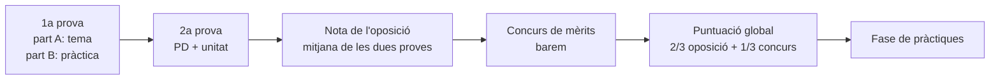

# 8. Oposicions: especialitat 254 · Informàtica

A la Comunitat Valenciana, l'especialitat **254 · Informàtica** pertany al **cos de professorat d'Ensenyament Secundari (0590)**. Aquesta pàgina resumeix com és el procediment d'ingrés prenent com a referència l'**última convocatòria, l'Ordre 1/2025, de 28 de gener** (modificada per l'Ordre 4/2025), i els **criteris d'avaluació publicats per la comissió de selecció** d'Informàtica.

> [!WARNING]
> Cada convocatòria pot canviar detalls (terminis, nombre de temes, format). Llig sempre l'**ordre de la convocatòria de l'any** i els criteris que publica la comissió de selecció de la teua especialitat.

## 8.1. El concurs oposició

- Les dues proves són **eliminatòries**: cal traure almenys un 5 en cadascuna.
- La nota de la fase d'oposició és la **mitjana aritmètica** de les dues proves.
- Només a qui supera l'oposició se li sumen els **mèrits** (experiència, formació, altres mèrits). La puntuació global pondera **2/3 l'oposició i 1/3 el concurs**.
- El 2025 es van convocar **60 places** d'Informàtica (54 lliures i 6 de reserva per a persones amb diversitat funcional).

## 8.2. Primera prova (coneixements de l'especialitat)

| Part | En què consisteix | Temps | Valor |
|---|---|:-:|:-:|
| **A** | Desenvolupament per escrit d'un tema triat entre **4 eixits per sorteig** dels **74 temes** del temari | 2 h | 5 punts |
| **B** | Prova pràctica amb diversos exercicis o supòsits | fins a 4 h | 5 punts |

Per a superar-la cal sumar almenys 5 punts i obtindre en cada part com a mínim el **25 %** del seu valor. Les proves escrites són **anònimes** (etiquetes), amb bolígraf blau o negre, sense corrector.

### Criteris de la part A (tema)

| Criteri | Pes |
|---|:-:|
| Estructura del tema: índex, introducció, desenvolupament, conclusió, relació amb el marc legal, bibliografia | 10 % |
| Expressió i presentació: claredat, correcció, vocabulari tècnic, llenguatge inclusiu | 10 % |
| Coneixement científic i innovació: profunditat, rigor, actualitat, inclusió, legislació, conclusió personal | 80 % |

### La part B (pràctica)

La comissió proposa dues o més opcions de prova pràctica, des d'un enfocament competencial i contextualitzat, sobre àmbits com: anàlisi i disseny d'aplicacions; programació estructurada i orientada a objectes; programació de serveis i processos; desenvolupament web client/servidor; aplicacions multiplataforma; bases de dades relacionals (definició, manipulació, administració); sistemes multiusuari i en xarxa; serveis de xarxa i Internet; programari lliure i propietari; administració d'una xarxa local. Es valora l'**estructura i presentació (5 %)** i el **contingut i la justificació didàctica (95 %)**: no n'hi ha prou amb resoldre; cal relacionar-ho amb el currículum, l'alumnat i la inclusió.

### El temari

El temari vigent de l'especialitat és l'aprovat per l'**Ordre d'1 de febrer de 1996** (BOE de 13 de febrer de 1996), amb **74 temes**. En el material tens també una proposta de temari actualitzat i un tema d'exemple.

## 8.3. Segona prova (aptitud pedagògica)

És la prova per a la qual et prepara aquest bloc.

| | |
|---|---|
| **Què es presenta** | Una **programació didàctica** d'un mòdul d'FP o una **programació d'aula** d'ESO o Batxillerat, personal i individual, amb la normativa vigent a la Comunitat Valenciana |
| **Quan es lliura** | Telemàticament, en la seu electrònica de la Generalitat, en un únic PDF de 25 MB com a màxim |
| **Preparació** | **60 minuts** per a preparar la unitat triada, amb el material que vulgues però sense connexió amb l'exterior |
| **Exposició** | Fins a **1 hora** en total: primer la **defensa de la programació (màxim 30 min)** i després l'**exposició de la unitat**. Al final, el tribunal pot fer preguntes |
| **Material en l'exposició** | Un exemplar de la teua programació, material auxiliar i un **guió d'un full (dues cares)** que es lliura al tribunal |
| **Elecció de la unitat** | Entre **tres extretes a l'atzar** de la teua programació (o de tres temes del temari, si optes per aquesta via) |

### Format de la programació

| Requisit | |
|---|---|
| Extensió | Màxim **60 pàgines** DIN-A4, sense comptar portada, índex i annexos |
| Annexos | Màxim **15 pàgines** |
| Lletra i interlineat | **Arial 12**, sense comprimir, interlineat **1,5** (senzill en taules i gràfics) |
| Portada | Nom i cognoms, DNI, cos i especialitat |
| Enllaços | **Prohibits** els hipervincles |
| Unitats | Almenys **sis** desenvolupades |

Cada incompliment de format resta **0,16 punts** (fins a 1 punt). Si la programació supera les pàgines permeses, les que sobren no es valoren. Si el tribunal detecta que no és d'elaboració pròpia, la nota de la prova és **0**.

### Criteris de la segona prova (Informàtica, 2025)

| Criteri | Pes |
|---|:-:|
| Aspecte formal: compleix la convocatòria, normativa vigent, bibliografia | 5 % |
| Aspectes pedagògics, didàctics, metodològics i d'avaluació | 25 % |
| Estructura i desenvolupament de la unitat i respostes al tribunal | 30 % |
| **Competència comunicativa** | **40 %** |

> [!IMPORTANT]
> El **40 % de la nota** depén de **com comuniques**: fluïdesa, seguretat, organització del discurs, exemples, llenguatge corporal, ús del material i respostes sense divagar. Per això dediquem desembre a assajar les exposicions ([tema 9](/t09-defensa)).

### Ortografia i redacció

En totes les proves escrites i en la programació es descompten: **0,25** per cada falta de grafia, **0,15** per cada accent i **0,05** per cada error gramatical o d'expressió (fins a 1 punt per part en la primera prova i fins a 2 en la programació).

## 8.4. Accés a la docència i altres eixides

- Per a ser docent en l'ensenyament públic o concertat necessites el **màster de professorat** (o la formació equivalent) a més de la titulació.
- Les **borses de treball** de la Conselleria i l'**oferta setmanal de llocs de difícil cobertura** permeten treballar com a interí o interina.
- El Ministeri ofereix places de **professorat visitant** i en centres espanyols a l'exterior.


- q: "Entre quants temes tries en la part A de la primera prova?"
  options: ["2", "4", "5"]
  answer: 1
  explain: "En la convocatòria de 2025, per a Informàtica es tria entre 4 temes eixits per sorteig dels 74 del temari."
- q: "Quant de temps com a màxim dura la defensa de la programació?"
  options: ["15 minuts", "30 minuts", "1 hora"]
  answer: 1
  explain: "La defensa de la programació no pot superar els 30 minuts; el conjunt amb la unitat, una hora."
- q: "Quin criteri pesa més en la segona prova d'Informàtica?"
  options: ["Aspecte formal", "Estructura i desenvolupament", "Competència comunicativa"]
  answer: 2
  explain: "La competència comunicativa suposa el 40 % de la nota de la segona prova."
- q: "Què passa si la teua programació inclou enllaços?"
  options: ["Res", "Es descompten 0,16 punts", "S'anul·la la prova"]
  answer: 1
  explain: "La presència d'hipervincles és un incompliment de format que resta 0,16 punts."


<!-- MATERIAL:inicio -->
## Material de l'assignatura

### Convocatòries

- 
- [Oposiciones 2025](https://ceice.gva.es/es/web/rrhh-educacion/2025-cos-de-professors-d-ensenyament-secundari-ingres-i-noves-especialitats)
- 
- [Convocatòria oposicions professors d'Ensenyament Secundari](https://ceice.gva.es/va/web/rrhh-educacion/2020-cos-de-professors-d-ensenyament-secundari/-/asset_publisher/uI0q0NZkFnmI/content/convocato-11?redirect=https%3A%2F%2Fceice.gva.es%2Fca%2Fweb%2Frrhh-educacion%2F2020-cos-de-professors-d-ensenyament-secundari%3Fp_p_id%3D101_INSTANCE_uI0q0NZkFnmI%26p_p_lifecycle%3D0%26p_p_state%3Dnormal%26p_p_mode%3Dview%26p_p_col_id%3Dcolumn-2%26p_p_col_count%3D1)
- [CUERPO DE PROFESORES DE ENSEÑANZA SECUNDARIA (ESTABILITZACIÓN: CONCURSO OPOSICIÓN) 2023](https://ceice.gva.es/va/web/rrhh-educacion/2022-cos-professors-ensenyament-secundari/-/asset_publisher/XcFvFcwQzTfH/content/convocatoria-3-1?_com_liferay_asset_publisher_web_portlet_AssetPublisherPortlet_INSTANCE_XcFvFcwQzTfH_assetEntryId=369444586&_com_liferay_asset_publisher_web_portlet_AssetPublisherPortlet_INSTANCE_XcFvFcwQzTfH_redirect=https%3A%2F%2Fceice.gva.es%2Fca%2Fweb%2Frrhh-educacion%2F2022-cos-professors-ensenyament-secundari%3Fp_p_id%3Dcom_liferay_asset_publisher_web_portlet_AssetPublisherPortlet_INSTANCE_XcFvFcwQzTfH%26p_p_lifecycle%3D0%26p_p_state%3Dnormal%26p_p_mode%3Dview%26_com_liferay_asset_publisher_web_portlet_AssetPublisherPortlet_INSTANCE_XcFvFcwQzTfH_cur%3D0%26p_r_p_resetCur%3Dfalse%26_com_liferay_asset_publisher_web_portlet_AssetPublisherPortlet_INSTANCE_XcFvFcwQzTfH_assetEntryId%3D369444586)

### Criteris d'avaluació dels tribunals

-  — Criterios de evaluación oposición 2025 informática
- **Criterios de evaluación de la oposición 2020**
  - 
  - 
  - 
  - 
- [Criterios de evaluación del proceso de estabilización 2022](https://ceice.gva.es/documents/162909733/372595656/254+cas_INFORM%C3%80TICA.pdf)
- **Documentación evaluación oposiciones**
  - 
  - 

### Temari de l'especialitat

-  — Contenido del temario para las oposiciones de la especialidad de informática LOE
-  — Temario de la especialidad de Informática del año 1996.
-  — Tema muestra localizado en internet.

### Accés a la funció docent

- 
- **Recursos normativa acceso a la función docente**
  - 
- 
- [Oferta semanal de puestos de difícil cobertura](https://ceice.gva.es/es/web/rrhh-educacion/convocatoria-y-peticion-telematica6)
- [La educación en el exterior](https://aee.educacionfpydeportes.gob.es/inicio.html)
- [Convocatòria profesores visitantes 26-27](https://www.educacionfpydeportes.gob.es/dam/jcr:71219dac-452c-409e-8433-8d021908b0e4/anexo-2.pdf)
<!-- MATERIAL:fin -->
